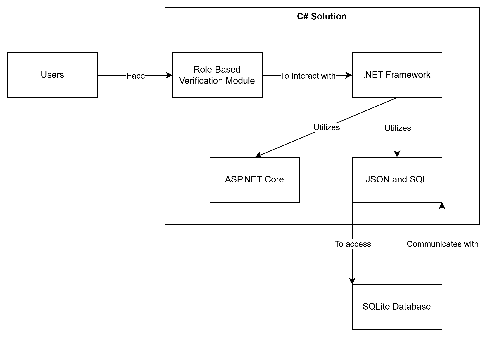
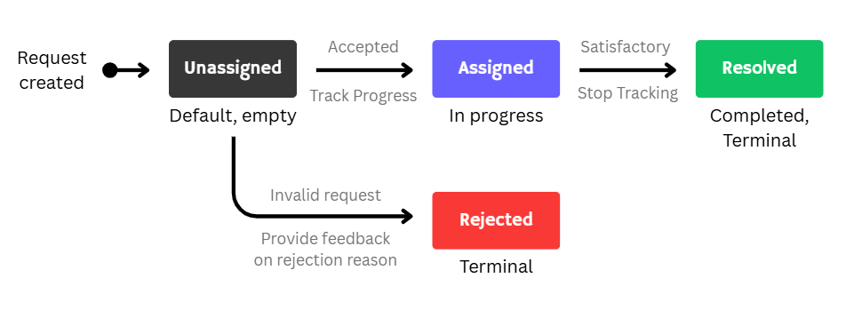
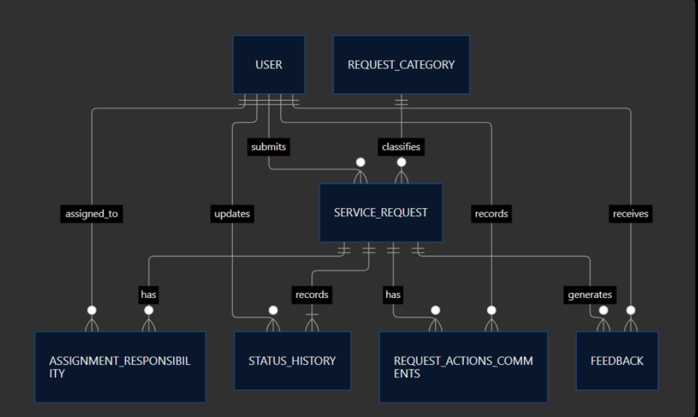

# 1. Project Engineering Document

> CivicConnect Public Service Reporting Platform
> **SEN381** *Integrated Team Project*

**Contributors:**

* Kasper van Niekerk (602622)
* Aidan Lakmeeharan (602899)
* Lethebe Kutloano (601712)

## 1.1. Contents

- [1. Project Engineering Document](#1-project-engineering-document)
  - [1.1. Contents](#11-contents)
  - [1.2. Change Control](#12-change-control)
  - [1.3. Executive Summary \& System Context](#13-executive-summary--system-context)
    - [1.3.1. System Context \& Problem Domain](#131-system-context--problem-domain)
  - [1.4. Business \& System Objectives](#14-business--system-objectives)
  - [1.5. Requirements Baseline (Functional \& Non-Functional)](#15-requirements-baseline-functional--non-functional)
    - [1.5.1. Functional Requirements](#151-functional-requirements)
    - [1.5.2. Non-Functional Requirements](#152-non-functional-requirements)
    - [1.5.3. Requirements Traceability Matrix (M1 Baseline / M2 Update)](#153-requirements-traceability-matrix-m1-baseline--m2-update)
    - [1.5.4. RTM — M3 Verification Trace](#154-rtm--m3-verification-trace)
  - [1.6. Project Scope, Boundaries \& Constraints](#16-project-scope-boundaries--constraints)
    - [1.6.1. In Scope](#161-in-scope)
    - [1.6.2. Out of Scope](#162-out-of-scope)
    - [1.6.3. Deferred](#163-deferred)
    - [1.6.4. Scope Acceptance Rules](#164-scope-acceptance-rules)
    - [1.6.5. Project Constraints](#165-project-constraints)
    - [1.6.6. System Constraints](#166-system-constraints)
  - [1.7. Stakeholder Identification \& Governance](#17-stakeholder-identification--governance)
  - [1.8. Team Working Agreement](#18-team-working-agreement)
  - [1.9. Forward Engineering Considerations (FEC)](#19-forward-engineering-considerations-fec)
    - [1.9.1. FEC-01: Traceability](#191-fec-01-traceability)
    - [1.9.2. FEC-02: Maintainability](#192-fec-02-maintainability)
    - [1.9.3. FEC-03: Testability](#193-fec-03-testability)
    - [1.9.4. FEC-04: Security \& Data Privacy](#194-fec-04-security--data-privacy)
    - [1.9.5. FEC-05: Handoff](#195-fec-05-handoff)
    - [1.9.6. FEC-06: Role and Visibility Configuration](#196-fec-06-role-and-visibility-configuration)
  - [1.10. Risk Identification and Management](#110-risk-identification-and-management)
  - [1.11. Baseline Sign-Off \& Gate Evidence](#111-baseline-sign-off--gate-evidence)
  - [1.12. System Architecture \& Design](#112-system-architecture--design)
    - [ASRs, Quality Drivers and Architecture decisions](#asrs-quality-drivers-and-architecture-decisions)
    - [Architecture / lifecycle design evidence](#architecture--lifecycle-design-evidence)
    - [Technology Decisions, integration and deployment compatibility](#technology-decisions-integration-and-deployment-compatibility)
    - [Data and persistence baseline](#data-and-persistence-baseline)
    - [Significant decisions/risks](#significant-decisionsrisks)
  - [1.13. Implementation \& Verification](#113-implementation--verification)
  - [1.14. Deployment, Operations \& SRE](#114-deployment-operations--sre)
  - [1.15. References \& Evidence Traceability](#115-references--evidence-traceability)
  - [1.16. Milestone 3 — Construction, Quality \& Release Readiness (Evidence Index)](#116-milestone-3--construction-quality--release-readiness-evidence-index)

---

## 1.2. Change Control

| **Version** | **Date** | **Last Edit** | **By** | **Reviewers** |
|---|---|---|---|---|
| 0.0.1 | 2026/09/08 | Document structure | Kasper | Aidan, Lethebe |
| 0.1.0 | 2026/09/08 | Convert to .md | Kasper | Aidan, Lethebe |
| 0.2.0 | 2026/09/09 | Consolidated PED_1, PED_2 and Member One's requirements/scope work into a single controlled document; corrected duplicate/malformed requirement IDs; added missing FR-015; updated NFR-003 to 99.9% availability target | Kasper | Aidan, Lethebe |
| 0.3.0 | 2026/09/09 | Appended AI Usage Register (from `docs/AI_USAGE_1.md`) and Engineering Decision Log (from `docs/decisions/ENG_DECISION_LOG.md`) as controlled PED sections; renumbered downstream sections | Kasper | Aidan, Lethebe |
| 0.4.0 | 2026/09/09 | Added Team Working Agreement (draft) and Baseline Sign-Off & Gate Evidence (draft, per Master Brief Appendix D) as controlled PED sections; renumbered downstream sections | Kasper | Aidan, Lethebe |
| 0.5.0 | 2026/09/09 | Reconciled repository PED.md (which had reverted to uncorrected content) against this corrected/consolidated version; added dedicated Project Constraints subsection (§1.6.5) with cost/quality/security trade-off; finalised Team Working Agreement roles and communication plan | Kasper | Aidan, Lethebe |
| 1.0.0 | 2026/09/09 | Formal Milestone 1 Baseline Submission | Team | Aidan, Lethebe |
| 2.0.0 | 2026/09/30 | M2 controlled update: ADR-04 lifecycle decision, ADR-05 authorization/visibility decision, ADR-06 technology-stack decision, data/persistence baseline, affected RTM evidence, initial Core implementation and 29 passing tests | Team | Aidan, Lethebe |
| 3.0.0 | 2026/10/16 | M3 controlled update: CR-M2-01 wording applied to FR table (DEF-02); RTM M3 verification trace (§1.5.4, from Member One's M3 review); M3 risks; M3 gate (§1.11); M3 implementation evidence (§1.13); staging (§1.14); M3 evidence index (§1.16) incl. Member One's baseline-conformance, defect, metric and debt analysis | Team (AI-assisted, AI-M3-02) | Aidan, Lethebe |
| 3.1.0 | 2026/10/16 | M3 rc2: release conditions closed (CI required and green; PR #14 approved by two reviewers; ADR-07, ADR-08 and CR-M3-02 accepted); DEF-10 fix; AI-M3-01/02 completed; 72-hour rationale (CR-M3-02); ADR-06 and §1.12 keep the M2 PostgreSQL baseline with an M3 note per ADR-07; stack diagram updated (Aidan); release identifier `m3-rc2` | Team | Documentation-only update merged by repository admin bypass before the deadline (reason recorded in the PR) |

---

## 1.3. Executive Summary & System Context

The CivicConnect platform is a digital service request management system engineered to solve operational inefficiencies in community service reporting. Currently, service issues (e.g., municipal faults, facility damage, security concerns, and IT support) are handled through decentralized channels including WhatsApp, email, paper logs, and phone calls. This project establishes a centralized, auditable, and traceable platform that connects Requesters, Operational Staff, and Management.

Milestone 1 establishes the controlled engineering foundation, baselining functional and non-functional requirements, scope boundaries, stakeholder governance, and risk mitigation strategies under strict configuration control.

### 1.3.1. System Context & Problem Domain

* **Current Operational Deficiencies:**
  * *Duplication & Loss:* Requests submitted across informal channels are frequently lost, duplicated, or misassigned.
  * *Lack of Visibility:* Citizens have zero visibility into ticket progress, status transitions, or resolution timelines.
  * *Weak Accountability:* No formal audit record exists to track staff actions, ownership changes, or management oversight.
* **Proposed Solution Boundaries:** CivicConnect provides a unified platform for service requests; from initial categorization and assignment to controlled status updates and final closure.

---

## 1.4. Business & System Objectives

The business needs a digital platform that will allow service requests to be submitted, managed, monitored and reported in a much more reliable manner. The digital platform, CivicConnect, is intended to streamline the service request process for the business and improve operational efficiency; this is the intended value the system will provide for the business. It will act as a centralized control system for service requests.

Regarding the need for the system within the business, CivicConnect will strengthen and increase the reliability of service request operations, staff and management/oversight capabilities. Service requesters will have better visibility regarding the current state of submitted requests and be able to view a history of submitted requests; they will receive feedback regarding the state of their service request and be able to categorise a request using the controlled category mechanism feature. Staff will be able to sort and search for requests and view full request details, be able to assign or accept responsibility for a request, update request status and resolve those requests when authorised.

Management will be able to view service activity information, be given reliable information about requests in order to identify whether they are open, overdue, resolved or closed, and use the available information to support accountability and service lifecycle analysis.

**Intended business value:**

- Reduced risk of requests being duplicated, overlooked or lost
- Improved visibility of request status for service requesters
- Clear communicated responsibility and ownership for staff members
- Greater accountability
- More reliable information for management regarding state of work
- Improved protection of sensitive request information
- Streamlined service request lifecycle process

---

## 1.5. Requirements Baseline (Functional & Non-Functional)

### 1.5.1. Functional Requirements

| Requirement ID | Source | Description | Priority | Status | Acceptance criteria |
|---|---|---|---|---|---|
| FR-001 | System (role-based access, all stakeholders) | The system shall allow authorised requester to perform authorised functions, according to their role | MUST | Proposed | A requester can only see their requests and not others. Staff can only access features they are permitted. Management features are unavailable to requesters and staff |
| FR-002 | Requester | The system must allow authenticated requester to submit requests | MUST | Clarified (CR-M2-01) | Submission form captures necessary service request details. When correct input is entered and submit is clicked, the system stores the service request linked to the requester, with initial status Unassigned |
| FR-003 | Requester | The system shall allow a requester to categorise a request | MUST | Proposed | The selected category is stored in correlation to the submitted service request |
| FR-004 | Requester | The system shall allow a requester to view status of their submitted requests | MUST | Proposed | The request status displays current status |
| FR-005 | Requester | The system shall allow requesters to view a history/list of their previously submitted requests | MUST | Proposed | The list shows service requests submitted by the requester and the relevant information. When no requests exist, an empty screen/history list is returned |
| FR-006 | Staff | The system shall allow authorised staff to search, filter and sort service requests | MUST | Proposed | Staff can search using matching data such as unique identifier for service request. Staff can filter by categories. Staff can sort by categories |
| FR-007 | Requester | The system shall provide meaningful feedback regarding the state of a request | MUST | Clarified (CR-M2-01: Rejected status exists and its reason is mandatory) | Each application feedback displays the relevant service request along with its status and reasoning for the status given |
| FR-008 | Staff | The system shall allow authorised staff to view full request details | MUST | Proposed | The system provides full service request details. A staff cannot view a request if they are not authorised for the request |
| FR-009 | Staff | The system shall allow an authorised staff to assign or accept responsibility for a request | MUST | Proposed | Responsibility is given by selecting another staff role. No other role but staff can assign/accept responsibility for a request |
| FR-010 | Staff | The system shall record material actions and comments associated with a request | MUST | Proposed | Comments will be saved as an entry with the author and description of the comment. Empty comments are rejected |
| FR-011 | Staff | The system shall allow authorised staff to resolve/close requests | MUST | Clarified (CR-M2-01) | After a service has been resolved, the requester will be able to see the new status. ~~Only a request in an approved state can be closed~~ → Only a request with status Assigned can be resolved (closed) |
| FR-012 | Management | The system shall allow authorised managers to view service activity information | MUST | Proposed | The overview does not expose request information outside the manager's authorised scope |
| FR-013 | Management | The system shall allow management to identify open (Unassigned or Assigned), overdue, and resolved (closed) requests | MUST | Changed (CR-M2-01, CR-M3-02) | Counts of open, overdue and resolved (closed) requests. Overdue means Unassigned/Assigned and strictly more than 3 days (72 hours) since submission; assignment does not reset the deadline; terminal requests are excluded. Overdue is included in Open. |
| FR-014 | Management | The system shall allow management to view request information according to filters such as category/status | MUST | Proposed | System provides filter options for managers to select from |
| FR-015 | Staff | The system shall allow authorised staff to update a request only through the defined status transitions in CR-M2-01 §3 | MUST | Changed (CR-M2-01) | ~~The system will only accept the following: Assigned, In Progress, Resolved, Closed~~ → Every listed transition (Unassigned→Assigned, Unassigned→Rejected, Assigned→Resolved) succeeds for authorised staff. Any unlisted transition is rejected and leaves the request unchanged. A rejection without a reason is refused |

### 1.5.2. Non-Functional Requirements

| Requirement ID | Source | Category | Description | Priority | Status | Verification |
|---|---|---|---|---|---|---|
| NFR-001 | Project Master Brief/projectmanagement.com | Performance | The system shall respond as intended during normal operational conditions | MUST | Proposed | Measured via load test |
| NFR-002 | Project Master Brief/projectmanagement.com | Security | The system should use HTTPS and use hashing to store passwords | MUST | Proposed | Inspect authentication configuration, pass when HTTPS is enforced and no plaintext passwords stored |
| NFR-003 | Project Master Brief/projectmanagement.com | Availability | The system must be able to achieve 99.9% availability | SHOULD | Proposed | Availability measurement |
| NFR-004 | Project Master Brief/projectmanagement.com | Reliability | A service request lifecycle will either save all request details or not when an error occurs during an assignment or status update, the database contains either the changed and completed result or the unchanged result | SHOULD | Proposed | Fault testing |
| NFR-005 | Project Master Brief/projectmanagement.com | Access control | The system shall prevent unauthorised and unauthenticated users from accessing service request information | MUST | Proposed | Security tests which confirm that protected endpoints reject unauthenticated users |
| NFR-006 | Project Master Brief/projectmanagement.com | Compatibility | The system shall operate on the latest stable versions available to the team | SHOULD | Proposed | Cross-browser testing |
| NFR-007 | Project Master Brief/projectmanagement.com | Data privacy | The system shall prevent requesters from viewing other requests that don't belong to them unless authorised | MUST | Proposed | Using two requester accounts and try to access other account's requests |
| NFR-008 | Project Master Brief/projectmanagement.com | Usability | Users should be allowed to complete service request functions without requiring any assistance | SHOULD | Proposed | Tested via completion rate and time taken to complete the service request process |

### 1.5.3. Requirements Traceability Matrix (M1 Baseline / M2 Update)

**Functional requirement traceability matrix:**

The quality drivers used are the following: D1 integrity and audit; D2 access and privacy; D3 lifecycle visibility and reporting; D4 availability; D5 normal-load response.

| Requirement ID | Stakeholder / Source | Requirement | Priority | Acceptance criteria | ASR / Quality driver | Architecture / module / component | Data / persistence impact | Design / interface decision | Technology decision | Implementation evidence | Verification evidence | Status | ADR / Change / risk reference |
| --- | --- | --- | --- | --- | --- | --- | --- | --- | --- | --- | --- | --- | --- |
| FR-001 | System (role-based access, all stakeholders) | The system shall allow authorised requester to perform authorised functions, according to their role | MUST | Requester scope is owner-only; Staff scope is the union of permitted Staff-group request types; Management has broader authorised scope | D2 | Authorization policy / request visibility | UserAccount / Role / StaffGroup (persistence pending) | Visibility policy + lifecycle authorization seam | ASP.NET Core authorization at application boundary (planned); Core authorization policy implemented | `src/CivicConnect.Core/Authorization/` and updated `Lifecycle/TransitionService.cs` | 29 Core tests passing, including authorization tests | In Development | ADR-05; RISK-001; RISK-M2-04 |
| FR-002 | Requester | The system must allow authenticated requester to submit requests | MUST | submit is clicked, the system stores the service request linked to the requester | D1, D2 | Request service | Service Request | Transactional create; validate before commit | PostgreSQL proposed and runtime pending | Planned | Tests for valid and invalid submission | M1 approved; M2 proposed; not implemented | DEC-M2-01,DEC-M2-03 |
| FR-003 | Requester | The system shall allow a requester to categorise a request | MUST | The selected category is stored in correlation to the submitted service request | D1, D3 | Category and request service | RequestCategory | Controlled category selection/validation | PostgreSQL proposed | Planned | Test for stored-data check regarding category selection | M1 approved; M2 proposed; not implemented | DEC-M2-01 |
| FR-004 | Requester | The system shall allow a requester to view status of their submitted requests | MUST | A requester may view status only for requests within their owner scope | D2, D3 | Request visibility policy | ServiceRequest ownership | Owner-scoped visibility | PostgreSQL proposed; application authorization implemented in Core | `src/CivicConnect.Core/Authorization/` | Authorization tests passing; repository/API integration planned | In Development | ADR-05; RISK-M2-04 |
| FR-005 | Requester | The system shall allow requesters to view a history/list of their previously submitted requests | MUST | Request history is limited to the requester's own scope | D2, D3 | Request visibility scope | ServiceRequest ownership | Owner-scoped list query (repository integration pending) | PostgreSQL proposed | `VisibilityScope` implemented; repository/API query integration deferred | Initial policy tests passing; query integration planned | In Development | ADR-05; FEC-03 |
| FR-006 | Staff | The system shall allow authorised staff to search, filter and sort service requests | MUST | Staff can only search/filter/sort requests within the union of request types permitted by their Staff groups | D3, D5 | Staff visibility scope + query filtering | RequestCategory / StaffGroup mapping (persistence pending) | Scoped filtering and sorting | PostgreSQL proposed | `VisibilityScope` and StaffGroup policy implemented in Core; query integration planned | Authorization tests passing; repository/API integration planned | In Development | ADR-05; RISK-M2-04 |
| FR-007 | Requester | The system shall provide meaningful feedback regarding the state of a request | MUST | Feedback contains request, status and reasoning | D1, D3 | Feedback information | Request query and feedback view | No external notification, In-app information viewing | PostgreSQL proposed and UI pending | Planned | Tests for status feedback and mandatory rejection reason | M1 approved; M2 proposed; not implemented | Clarification required; RISK-M2-05 |
| FR-008 | Staff | The system shall allow authorised staff to view full request details | MUST | A Staff member cannot view a request outside the request types permitted by their groups | D2 | Request-level visibility policy | ServiceRequest + RequestCategory + StaffGroup (persistence pending) | Same visibility policy used for individual access and list scope | ASP.NET Core authorization planned at application boundary | `src/CivicConnect.Core/Authorization/` | Authorization tests passing; API integration planned | In Development | ADR-05; RISK-001; RISK-M2-04 |
| FR-009 | Staff | The system shall allow an authorised staff to assign or accept responsibility for a request | MUST | Staff-only assignment/acceptance | D1, D2 | Assignment/ acceptance commands | AssignmentResponsibility | Staff scope check and closing of previous active assignment | PostgreSQL proposed | Planned | Authorisation tests for assignment and acceptance | M1 approved; M2 proposed; not implemented | DEC-M2-03; RISK-M2-03 |
| FR-010 | Staff | The system shall record material actions and comments associated with a request | MUST | Comments will be saved as an entry with the author and description of the comment | D1 | Request event service | RequestActionComment | Append attributed, non-empty comment | PostgreSQL proposed | Planned | Tests covering recordings and recorded actions | M1 approved; M2 proposed; not implemented | DEC-M2-01,DEC-M2-03; RISK-M2-03 |
| FR-011 | Staff | The system shall allow authorised staff to resolve/close requests | MUST | Requester sees resolved status; only approved state closes | D1, D3 | Request lifecycle query | Current status and Status History | Proposed RESOLVED→CLOSED, pending approved-state | PostgreSQL proposed | Planned | Tests to resolve and close service requests | M1 approved; M2 proposed; not implemented | DEC-M2-03; RISK-M2-05 |
| FR-012 | Management | The system shall allow authorised managers to view service activity information | MUST | Manager view is limited to the manager's authorised reporting scope; current Core policy provides the broader Manager scope, with reporting query integration deferred | D2, D3 | Manager visibility scope | ManagementReportingView / ServiceRequest | Manager-scoped reporting query | PostgreSQL proposed | `RoleVisibilityPolicy` provides Manager scope in Core; reporting/API integration planned | Authorization tests passing; reporting integration planned | In Development | ADR-05; RISK-M2-04 |
| FR-013 | Management | The system shall allow management to identify open, overdue, resolved, and closed requests | MUST | Counts must be calculated only from the manager's authorised reporting scope | D3 | Manager-scoped reporting | ServiceRequest | Manager-scoped count query | PostgreSQL proposed | Authorization scope implemented; reporting query pending | Planned | In Development | ADR-05 |
| FR-014 | Management | The system shall allow management to view request information according to filters such as category/status | MUST | Manager filters operate within the manager's authorised scope | D2, D3 | Manager visibility + filtered reporting | ServiceRequest / RequestCategory | Manager-scoped filtered query | PostgreSQL proposed | Authorization scope implemented; reporting query pending | Planned | In Development | ADR-05 |
| FR-015 | Staff | The system shall allow authorised staff to update a request through defined status transitions | MUST | Only accepts Assigned, In Progress, Resolved, Closed | D1 | RequestCommandService | ServiceRequest – current Status | Explicit transition policy | PostgreSQL proposed | Planned | Tests for valid/invalid status-transition enforcement | M1 approved; M2 proposed; not implemented | DEC-M2-03; RISK-M2-03 / RISK-M2-05 |

**Non-functional requirement traceability matrix:**

| Requirement ID | Stakeholder / Source | Requirement | Priority | Acceptance criteria | ASR / Quality driver | Architecture / module / component | Data / persistence impact | Design / interface decision | Technology decision | Implementation evidence | Verification evidence | Status | ADR / Change / risk reference |
| --- | --- | --- | --- | --- | --- | --- | --- | --- | --- | --- | --- | --- | --- |
| NFR-001 | Project Master Brief/projectmanagement.com | The system shall respond as intended during normal operational conditions | MUST | Measured via load test | D5 | Query performance | Measure reporting queries as history grows. | Bounded query size | PostgreSQL | Planned | load test results after threshold approved | M1 approved; M2 proposed; not implemented | DEC-M2-01; RISK-003 |
| NFR-002 | Project Master Brief/projectmanagement.com | The system should use HTTPS and use hashing to store passwords | MUST | HTTPS enforced; no plaintext passwords | D2 | Identity and deployment | Store has passwords only | Credential handling | Secure password storage such as bcrypt. TLS config for HTTPS enforcing | Planned | HTTPS config and stored-hash analysis | M1 approved; M2 proposed; not implemented | RISK-001; stack ADR pending |
| NFR-003 | Project Master Brief/projectmanagement.com | The system must be able to achieve 99.9% availability | SHOULD | Monitoring testing and maintenance logs | D4 | Category and require services | Single database failure interrupts system workflows. Backups/restores must be available | Document recovery | PostgreSQL and recovery plans proposed | Planned | monitoring and maintenance logs | M1 approved; M2 proposed; not implemented | RISK-004 / RISK-M2-01; scope clarification |
| NFR-004 | Project Master Brief/projectmanagement.com | A service request lifecycle will either save all request details or not when an error occurs during an assignment or status update, the database contains either the changed and completed result or the unchanged result | SHOULD | Fault testing | D1 | Request command services | ServiceRequest, Status History, AssignmentResponsibility | Transaction and version check | PostgreSQL proposed transactions | Planned | Concurrent update testing | M1 approved; M2 proposed; not implemented | DEC-M2-03; RISK-M2-03 |
| NFR-005 | Project Master Brief/projectmanagement.com | The system shall prevent unauthorised and unauthenticated users from accessing service request information | MUST | Authorisation security tests | D2 | Authorization policy / request visibility | Request queries must apply authorised role and ownership/group scope before returning rows | Server-side checks; single policy for list and item access | ASP.NET Core authorization planned at application boundary; Core visibility policy implemented | `src/CivicConnect.Core/Authorization/` | 29 Core tests passing; endpoint/query security tests planned when API exists | In Development | ADR-05; RISK-001; RISK-M2-04 |
| NFR-006 | Project Master Brief/projectmanagement.com | The system shall operate on the latest stable versions available to the team | SHOULD | Access control tests | D2 | User interface | N/A | Compatible UI | Browser/front-end choice pending | Planned | Integration and latest version tests | M1 approved; M2 proposed; not implemented | UI/stack ADR pending |
| NFR-007 | Project Master Brief/projectmanagement.com | The system shall prevent requesters from viewing other requests that don't belong to them unless authorised | MUST | URL and API testing across two accounts | D2 | Authorization policy / request visibility | Each request is linked to its owner; Staff access is additionally constrained by group/request-type scope | Row/list scope enforced server-side | PostgreSQL ownership FK proposed; API enforcement pending | `VisibilityScope` and `RoleVisibilityPolicy` implemented in Core | 29 Core tests passing; cross-account URL/API tests planned at application boundary | In Development | ADR-05; RISK-001; RISK-M2-04 |
| NFR-008 | Project Master Brief/projectmanagement.com | Users should be allowed to complete service request functions without requiring any assistance | SHOULD | Completion rate and time taken to complete service request tests | D2 | User interface and workdlow | Clear status/feedback data supports task | Accessible forms and feedback | Front-end stack pending | Planned | defined usability task and timed study | M1 approved; M2 proposed; not implemented | UI/design ADR pending |

### 1.5.4. RTM — M3 Verification Trace

The M1/M2 matrix above is preserved unchanged as the earlier baseline. This table continues it for M3:
**stakeholder need → requirement → acceptance criterion → implementation → test case(s) → expected result →
execution evidence → defect/status**. The first draft of this trace (rows, acceptance criteria and gap analysis)
was produced by Member One during the M3 review. Statuses were then updated as implementation and test evidence became available.

**Execution evidence key:** **R1** = full automated run, 72/72 passed, commit `c5778f9`, 2026-10-16 ([test evidence](../quality/TEST_EVIDENCE.md)), repeated by CI on every push. **S1** = E2E run against staging release `c5778f9` ([staging](../deployment/STAGING.md)). **P1** = [load test](../quality/PERFORMANCE_TEST.md).

| Req | Stakeholder need | Acceptance criterion | Implementation | Test case(s) | Expected result | Evidence | Defect / status |
|---|---|---|---|---|---|---|---|
| FR-001 | Stakeholders' actions are limited to their role | Requesters and Managers cannot perform Staff lifecycle actions; only Requesters submit | `RoleVisibilityPolicy`, `TransitionService`, `RequestService`, API fallback policy | `Only_staff_may_change_status`; `Staff_can_change_status_when_authorized_by_the_policy`; `Manager_can_view_requests_but_cannot_change_status_through_this_policy`; `DT1`; `EP2`; `API5` | Staff in scope succeeds; Requester/Manager refused (403); nothing saved | R1 | **Verified** (Core + HTTP) |
| FR-002 | Requesters can submit a request | Valid input stores a request linked to the requester with status Unassigned; invalid input is refused and stores nothing | `RequestService.SubmitAsync`, `POST /api/requests`, UI form | `Submitted_request_is_stored_with_owner_category_and_initial_status`; `EP1`; `API3`; `API6` (BVA); `E2E1` | 201 + Unassigned; blank/over-length/unknown category → 400 | R1, S1 | **Verified** |
| FR-003 | Requests are categorised from a controlled list | Category must exist in the catalogue; stored with the request | `categories` table + FK, `GET /api/categories`, catalogue spelling (DEF-08) | `EP1` (unknown, mixed-case); `API3` | Unknown → `InvalidCategory`; `roads` stored as `Roads` | R1 | **Verified**; DEF-08 closed |
| FR-004 | Requesters see the current status of their requests | The requester sees the correct stored status of their own request | `GET /api/requests/{id}`, UI list/detail | `D1`; `ST1`; `E2E1`; `E2E2` | Own request returned with current status (Unassigned → Resolved/Rejected) | R1, S1 | **Verified** |
| FR-005 | Requesters see their request history/list | List contains only the requester's requests; empty list when none | `VisibilityScope` filtered in SQL, `GET /api/requests` | `Requester_cannot_read_another_requesters_request_from_the_database`; `D2`; `API4` | Others' requests excluded; no requests → `[]` | R1 | **Verified** |
| FR-006 | Staff locate requests within their scope | Search by identifier, filter and sort by category, limited to permitted types | Scope filter in SQL; `category`, `status`, `sortByCategory` query parameters | `Staff_only_see_requests_in_their_groups_categories`; `Staff_visibility_is_the_union_of_all_group_request_types` | Only permitted categories visible | R1 | **Partially verified**: scope verified; filter/sort parameters exist but have no dedicated test; free-text search not implemented |
| FR-007 | Requesters receive meaningful feedback | Rejection requires a non-blank reason; the requester can see status and reason | `TransitionRules`, `TransitionService`, history in request detail, UI history list | `Reject_without_reason_is_refused_and_nothing_is_saved`; `Rejection_audit_records_server_time_actor_and_only_relevant_information`; `API7`; `E2E2` | Blank reason → `MissingReason`, nothing saved; requester sees Rejected + reason | R1, S1 | **Verified** (in-app feedback; no notifications, as per scope) |
| FR-008 | Staff must not access requests outside their permissions | Staff visibility is the union of their groups' request types, enforced for detail and changes | `StaffGroup`, `VisibilityScope`, SQL filter, `TransitionService` `CanView` check | `Staff_visibility_is_the_union_of_all_group_request_types`; `Staff_only_see_requests_in_their_groups_categories`; `Staff_outside_request_category_cannot_change_status`; `DT1` R3 | Out-of-scope request invisible and not changeable | R1 (mutation-checked) | **Verified**; DEF-01 closed |
| FR-009 | Controlled allocation of responsibility | Assignment from Unassigned needs an assignee who is in-scope Staff | `TransitionRules`, `TransitionService` assignee check, `assignment_history` | `Assign_succeeds_and_saves_once`; `DT1`; `ST1`; `E2E1` | Valid assignment saved with assignee; others refused | R1, S1 | **Verified**; reassignment (`RequestService.ReassignAsync`) implemented but not exposed or tested |
| FR-010 | Material actions/comments are recorded | Comments saved with author; empty comments rejected; every transition audited | `transition_history`, `request_comments`, `POST /api/requests/{id}/comments` | Transition audit: `Rejection_audit_records_...`, `Failed_audit_write_rolls_back_the_status_change` | Audit entry per transition | R1 | **Partially verified**: transition audit verified; comment endpoint untested |
| FR-011 | Requests close only under defined conditions | Only Assigned can be Resolved, with a resolution note; requester sees Resolved | `RequestStatus`, `TransitionRules`, `TransitionService` | `Resolve_without_note_is_refused`; `Cannot_resolve_an_unassigned_request`; `ST1`; `E2E1` | Missing note / Unassigned → refused; valid resolve persisted and visible | R1, S1 | **Verified** |
| FR-012 | Managers see service activity | Overview without exposing data outside the approved scope | `GET /api/reports/counts` (Manager role), Manager scope | `Manager_can_view_requests_but_cannot_change_status_through_this_policy`; `API8` | Manager gets counts; Staff 403 | R1 | **Partially verified**: counts only; no richer activity view |
| FR-013 | Managers see counts by lifecycle condition | Open, overdue and resolved counts; overdue strictly after 72 hours while open (CR-M3-02) | `OverduePolicy`, `SqliteRequestRepository.GetCountsAsync`, summary/detail API, deadline filter and Manager count UI | `API8`; `OverdueTests`; `OverdueApiTests` | Exact deadline not overdue; +1 tick overdue; terminal states excluded; scope/filters preserved | R1; `docs/quality/TEST_EVIDENCE.md` overdue follow-up | **Verified** by automated Core/SQLite/HTTP cases and a 19-check exploratory run; DEF-07 closed; CR-M3-02 accepted |
| FR-014 | Managers filter by category/status | Filtered counts/lists within the Manager's scope | `category`/`status` parameters on counts and list | — | — | — | **Implemented, unverified** (no dedicated test) |
| FR-015 | Consistent lifecycle (amended by CR-M2-01) | Only Unassigned→Assigned, Unassigned→Rejected, Assigned→Resolved; all others refused, nothing changed | `RequestStatus`, `TransitionRules`, `TransitionService` | `Table_allows_only_the_three_approved_transitions` (16 pairs); `Terminal_requests_cannot_be_assigned_again`; `ST1`; `API7` | Exactly 3 of 16 pairs allowed; invalid → `InvalidTransition`/409 | R1 | **Verified**; DEF-02 closed (wording reconciled) |
| NFR-001 | Acceptable response under normal load | No numeric target set | Indexes, WAL mode | Load test 1 and 10 users | Compared with the 1-user baseline (no formal target) | P1 | **Measured, no target**; DEF-09 mitigated |
| NFR-002 | Secure credentials and transport | No plaintext passwords; HTTPS enforced | PBKDF2 hashes (ADR-08); `RequireHttps` in Production | `API2` (login); code review of `PasswordHasher` | Hashes only; HTTPS on in Production config | R1 | **Partially verified**: hashing verified; HTTPS not exercised (TD-07) |
| NFR-004 | Reliable updates | Status + audit saved atomically; stale updates do not overwrite | `SaveTransitionAsync` transaction + version check | `Failed_audit_write_rolls_back_the_status_change`; `Stale_transition_is_reported_as_conflict_and_changes_nothing`; `Concurrent_change_is_reported_as_conflict`; `Storage_failure_propagates_and_is_not_reported_as_success` | Rollback leaves status/version/history unchanged; stale save returns conflict | R1 | **Verified** on SQLite (not PostgreSQL) |
| NFR-005 | Unauthenticated users cannot access information | Protected endpoints reject unauthenticated callers | Cookie authentication, fallback authorization policy | `API1` | 401 on all protected endpoints | R1 | **Verified** |
| NFR-007 | Requester privacy | Requesters cannot access other requesters' records | Owner scope in SQL; 404 for others' ids | `Requester_can_view_only_their_own_requests`; `Requester_cannot_read_another_requesters_request_from_the_database`; `API4` | Detail 404, list excludes | R1 | **Verified** (Core, database and HTTP) |

---

## 1.6. Project Scope, Boundaries & Constraints

The scope of CivicConnect is to provide a digital platform that the business will use to submit, manage and report on service requests in a more reliable manner. It prioritises the reliable management and traceability of service requests over other features. The scope is needed to ensure that stakeholder needs remain achievable within project constraints and to provide enough detail to guide team members through the project lifecycle.

### 1.6.1. In Scope

**Requester capabilities:**
- Submitting a new request with appropriate information
- Ability to categorise a request
- Viewing the status of submitted requests
- Viewing history of submitted requests
- Receive feedback regarding request status (accepted, rejected, updated or completed)
- Viewing only request information that the requester has access to

**Staff capabilities:**
- Viewing service requests relevant to the authorised staff
- Searching, filtering or sorting actions on requests
- Viewing full request details
- Assigning or accepting responsibility for a request
- Ability to update request status
- Recording relevant information, actions or comments
- Resolving or closing requests where authorised

**Management and oversight capabilities:**
- Viewing service activity information
- Identify requests according to states (open, overdue, resolved, and closed)
- Viewing request information by selected filters: category and status
- Accessing enough information to support accountability and service-performance analysis

**System capabilities:**
- User access and authorization based on roles and responsibilities
- Validation of service request input
- Storage of request details, ownership, status and lifecycle history
- Protection of sensitive information
- Show each requester their own request list, current status and feedback

### 1.6.2. Out of Scope

- Creation of a Native Android or iOS mobile application
- Importing of requests from external platforms/systems such as WhatsApp, email, telephone systems, etc.
- Payment functions/financial transactions
- Inventory control, asset management functions of the service requests
- Functionality unrelated to service-request lifecycle
- Purchase or installation of hardware
- Failure recovery. CivicConnect is responsible for ensuring reliable delivery of the service request lifecycle; it will not perform any maintenance should a failure occur.

### 1.6.3. Deferred

- Integration with existing external systems
- Notification system regarding the state of service request
- Requester satisfaction, making use of feedback services for evaluations
- Exporting reports to text-document formats
- Automatic escalation of overdue service requests
- Configurable management dashboards

**Deliberate exclusion:** Importing from WhatsApp, Email, telephone systems, etc.

Focus will be purely emphasized upon the service request lifecycle. Having importing from WhatsApp, email, and other platforms might introduce integration complexity and additional testing, shifting the focus from the core feature expressed to ensuring that the importing works. Whilst the importing will remove manual data capture, it still is an uncertainty to include within the system.

### 1.6.4. Scope Acceptance Rules

- In-scope, out-of-scope and deferred scope items must not contradict each other.
- Every requirement appears within the RTM.
- The team must confirm that the committed scope is feasible within the upcoming and available milestones.
- Stakeholders and team members review documentation and approvals are recorded.
- Every in-scope feature must possess a unique requirement identifier.
- Requirement and scope identifiers must remain stable across milestones.
- The team must use a change request and impact analysis before altering any scope/requirement items.
- A MUST requirement belongs to the committed baseline unless formally altered by the team.
- A SHOULD requirement may be deferred through documented impact analysis.
- A COULD requirement is optional and must not replace a MUST requirement.

### 1.6.5. Project Constraints

| Constraint | Minimum Expectation for CivicConnect | Engineering Implication |
|---|---|---|
| Team size | Exactly 3 registered students (Kasper, Aidan, Lethebe). | Individual accountability evidence (§1.8, §1.11) must be traceable per member, not only per team. |
| Schedule | Four formal milestones across the SEN381 delivery period; M1 baseline due before M2 architecture work begins. | Technology-stack and architecture decisions are deliberately deferred to M2 (DEC-M1-02, §1.12) rather than rushed now. |
| Cost | Prefer free/low-cost services; operational cost beyond the educational context must be identified. | Directly drives RISK-002 (§1.10); any paid service/technology requires a cost check and Decision Log entry before adoption. |
| Scope | Baselined scope (§1.6.1–1.6.3) is controlled; changes require impact analysis, not silent absorption. | The deliberate WhatsApp/email-import exclusion (§1.6.3) is the first tested case of this control. |
| Quality | Quality attributes must be measurable, not asserted (NFR-001–NFR-008, §1.5.2). | Claims like "the system is reliable" are insufficient without the linked test evidence required from M3 onward. |
| Security | Security is lifecycle-wide, not a final add-on. | FEC-04 (§1.9) and NFR-002/NFR-005/NFR-007 (§1.5.2) commit the team to access control, HTTPS, and data-privacy requirements from the requirements stage, before any code exists. |
| Technology | No stack is prescribed; selection must be justified against requirements, team capability, and constraints. | Formally deferred to M2 via DEC-M1-02 (§1.12), informed by the FR/NFR baseline above. |

**Interaction/trade-off worth noting:** the Cost constraint and the Quality/Security constraints pull in opposite directions — preferring free-tier services (Cost) can mean weaker built-in security or reliability guarantees (Quality, Security, RISK-001/RISK-004), so free-tier selections in M2 will need an explicit check against NFR-002, NFR-005 and NFR-007 rather than being chosen on price alone.

---

### 1.6.6. System Constraints

**Schedule:** The schedule of the project follows four milestones, one of which is the submission of this section. The final milestone will be submitted by the 18th of October.

**Cost:** The project should have minimal costs, that do not financially burden the community or business. Free software should be used where possible.

**Scope:** Functional requirements outlined earlier in the document need to be adhered to, non-functional requirements can be deferred to another time if necessary. Costs need to be respected, the project must be completed on time, along with all quality requirements being met.

**Quality:** The project needs to be functional, reliable, stable, usable by the majority of participants, and allow for potential improvements.

**Security:** Data needs to be kept secure, backed up, relevant and reliable. Should there be any data risks, systems such as backups need to be kept up to date.

---

## 1.7. Stakeholder Identification & Governance

**Stakeholders:**

**Staff:** Reporting staff working with CivicConnect have a stake in the project as they are the ones who are going to be using the system. Their interests and feedback will have significant contributions to the project with regards to its user interface, accessibility, as well as the product testing.

**Contractors:** Any service requests, requirements, payments and communications for contractors go through CivicConnect. As such, any potential contractor would have a stake in the project. However, it would be difficult to consult with potential contractors as they can change with each project and dependent on their tenders. They will therefore be considered, however are not significant stakeholders in the project.

**Communal Users:** The community that uses CivicConnect will want to understand how the software works, and their input for the development of CivicConnect will be required to allow for a functional and satisfactory product upon completion.

**Business and Financial Stakeholders:** The business, as well as its and any other financial backers, will want to ensure that they get value out of the product they are investing in, as well as a return on their investment. As such they have a significant stake and interest in a successful outcome of the project.

**Additional parties of interest:**

**Government Regulatory Bodies:** Regulatory Bodies would want to ensure that CivicConnect complies with code requirements and regulations. As such, the development team needs to ensure that any potential regulatory requirements are analysed and adhered to within the project scope.

**SARS:** The South African Revenue Service will want financial reports with respect to the project, as well as potential information relating to audits. This is both to ensure lawful compliance, as well as required taxes that can arise from the product's potential profits or losses.

---

## 1.8. Team Working Agreement

**Team members:** Kasper van Niekerk (602622), Aidan Lakmeeharan (602899), Lethebe Kutloano (601712)

**Purpose:** This agreement records how the team will collaborate, communicate, take decisions and hold each other accountable across the CivicConnect project, in line with Master Project Brief §8 (Team Engineering and Individual Accountability).

**Collaboration & communication**
- Primary communication channel: team WhatsApp group for day-to-day coordination; formal decisions and substantive discussion recorded via GitHub Issues/PRs, not left only in chat.
- Standing check-in cadence: weekly sync ahead of each milestone deadline, plus ad hoc check-ins as needed.
- All substantive engineering discussion and decisions that affect the baseline must be reflected in a controlled artefact (Decision Log, PR, or issue); not left only in chat.

**Roles (may be adjusted per milestone, but do not remove collective responsibility per §8)**
- Requirements & Documentation Lead — Kasper
- Architecture/Backend Lead — Aidan
- Quality & Risk Lead — Lethebe
- Roles rotate or share workload as needed; every member remains individually responsible for understanding the complete project per Master Brief §8.

**Decision-making**
- Minor/technical decisions within an individual's assigned area may proceed without full team sign-off, but must be logged in the Decision Log.
- Decisions affecting baselined scope, requirements, architecture or shared infrastructure require agreement from all three members before being actioned.
- Disagreements that cannot be resolved within the team will be raised with the lecturer rather than left unresolved.

**GitHub & review conduct**
- Every substantive change to controlled artefacts (documentation or code) goes through a Pull Request; no direct commits to `main`.
- Minimum of two approvals from members other than the author, per Master Brief §9. Self-approval is not accepted.
- Reviewers are expected to leave meaningful comments (see Master Brief §9.1), not rubber-stamp approvals.

**Accountability & conduct**
- Each member commits to producing the minimum individual evidence required by Master Brief §8.1 (meaningful commits, PRs authored and reviewed, contribution to decision records, ability to trace and defend at least one requirement).
- A member unable to meet a commitment must raise this with the team as early as possible, not at the deadline.
- All members are expected at every milestone presentation and individual defence per Master Brief §19; attendance is not optional and is not substitutable by another member's contribution.

**Conflict handling**
- Concerns about workload distribution or contribution imbalance will be raised directly and early within the team.
- If unresolved, the concern will be escalated to the lecturer before it affects milestone delivery.

**Agreement**

| Member | Agreed (Y/N) | Date |
|---|---|---|
| Kasper van Niekerk | Y | 2026/09/09 |
| Aidan Lakmeeharan | Y | 2026/09/09 |
| Lethebe Kutloano | Y | 2026/09/09 |

---

## 1.9. Forward Engineering Considerations (FEC)

### 1.9.1. FEC-01: Traceability

* **Planning Influence**: Facilitating tracking and auditing service requests (required for accountability) will require specific data solutions and transaction management, directly impacting technology and architecture choice.
* **Future Influence**: Data structure, storage policy, and audit log design.
* **Information Needs**: Log retention timeline, compliant audit attributes to be collected.
* **Risk If Ignored**: Poor management capabilities as requests cannot be linked to the agents that changed them, causing errors to compound as they cannot be monitored to be detected. Legal trouble when services cannot be linked to requests via audit.

### 1.9.2. FEC-02: Maintainability

* **Planning Influence**: Designing to facilitate future code changes and ease of maintenance requires modular, loosely coupled code that directly influences architecture design. It will also guide code structures and documentation requirements from the start, and so must be planned for early.
* **Future Influence**: Code structure, backend stack options, documentation, module design, coupling, API format.
* **Information Needs**: Stack choice, hand-off requirements, final software lifetime and maintenance scope.
* **Risk If Ignored**: If the team doesn't explicitly develop with maintainability in mind then systems will be tightly coupled and individual services cannot be updated. Instead time and costs increase as the ecosystem must be overhauled to suit small changes, which is unacceptable.

### 1.9.3. FEC-03: Testability

* **Planning Influence**: A testable system requires isolated components with independent functionality that can be separately verified so a nested failure doesn't go unnoticed and cause cascading failures. This will directly impact coding strategy and validation processes, and should be accounted for before moving to the design phase.
* **Future Influence**: Component scope and communication, verification process, test suites.
* **Information Needs**: Component granularity, service complexity, code coverage goals, and the selected testing tools/frameworks.
* **Risk If Ignored**: Even a well designed system cannot be analysed and corrected if it cannot be properly tested. Without proper testability architecture in place, errors will accumulate and undermine the functionality and reliability of the system, including security.

### 1.9.4. FEC-04: Security & Data Privacy

* **Planning Influence**: Security will directly impact the system approach to ensure role-based access is enforced at every step of the program, while data privacy similarly affects data collection and retention considerations, thereby impacting both the frontend and backend planning.
* **Future Influence**: User account management, verification, recovery strategies, encryption, backup management, role management.
* **Information Needs**: Data retention regulations, privacy regulations, required user information, variation of roles required, chosen stack encryption support.
* **Risk If Ignored**: Data loss or leak that can lead to system interruptions, failure, and legal action. Account failures leading to unauthorized actions or unrecoverable roles.

### 1.9.5. FEC-05: Handoff

* **Planning Influence**: The final interface should be operable by non-technical municipal staff. Onboarding, user roles, system administration, and help documentation must be planned early so the system doesn't rely on developers for day-to-day use.
* **Future Influence**: Admin UI design, user role management, system setting controls, error messages, and admin/user documentation.
* **Information Needs**: Target admin skill level, required system settings (like ticket categories and department routing), and training documentation scope.
* **Risk If Ignored**: Non-technical staff won't be able to run the system, change settings, or onboard new agents without developer intervention. This leads to mismanaged requests, system misuse, and high maintenance overhead.

### 1.9.6. FEC-06: Role and Visibility Configuration

* **Planning Influence**: Request visibility is a dedicated authorization responsibility rather than being embedded in lifecycle logic. Requester ownership, Staff group/request-type scope and Manager scope must remain enforceable at the server-side application boundary.
* **Future Influence**: User/role persistence, StaffGroup membership, request-type/category mapping, API authorization, repository query scoping and manager administration.
* **Information Needs**: Final role/group administration model, authentication provider, persistence schema for Staff groups and request types, and exact manager reporting scope.
* **Risk If Ignored**: Authorization rules may diverge between list queries, individual-request access and lifecycle operations, creating unauthorized disclosure or inconsistent permissions.
* **Current M2 evidence**: `CivicConnect.Core/Authorization/` implements the initial policy boundary and `VisibilityScope`; lifecycle authorization now consumes that boundary. Repository/API/database integration is deferred.

* **Planning Influence**: The final interface should be operable by non-technical municipal staff. Onboarding, user roles, system administration, and help documentation must be planned early so the system doesn't rely on developers for day-to-day use.
* **Future Influence**: Admin UI design, user role management, system setting controls, error messages, and admin/user documentation.
* **Information Needs**: Target admin skill level, required system settings (like ticket categories and department routing), and training documentation scope.
* **Risk If Ignored**: Non-technical staff won't be able to run the system, change settings, or onboard new agents without developer intervention. This leads to mismanaged requests, system misuse, and high maintenance overhead.

---

## 1.10. Risk Identification and Management

P: Probability (Low, Medium, High)
I: Impact (Low, Medium, High)

| Risk ID | Description | Cause | P | I | Priority | Mitigation | Contingency | Owner | Status |
|---|---|---|---|---|---|---|---|---|---|
| RISK-001 | Sensitive request/personal data is exposed, leaked, or accessed without authorisation | Insufficient access control, weak authentication, unencrypted storage/transit | M | H | High | Enforce role-based access control, encryption in transit/at rest, two-factor authentication for staff/management accounts | Revoke or rotate credentials, disable affected access, review audit records, notify stakeholders | Aidan | Open |
| RISK-002 | Project cost exceeds the team's available/educational budget | Reliance on paid technologies, subscriptions, or services not evaluated for cost before adoption | M | M | Medium | Investigate and document cost of any new technology/service before adoption; prefer free/low-cost tiers where practical | Fall back to free or self-hosted options and defer non-essential services through change control | Kasper | Open |
| RISK-003 | Delivered software fails to meet baselined quality/functional standards | Technology limitations, incomplete testing, or inconsistent individual contribution | M | H | High | Stage-gate review of each milestone's artefacts against acceptance criteria before sign-off | Defer SHOULD requirements through impact analysis rather than reducing testing | Lethebe | Open |
| RISK-004 | System is unavailable or degrades during peak usage, causing service disruption | Single central database server, latency, connectivity issues, power outages, hosting constraints | M | M | Medium | Select hosting with acceptable uptime guarantees; monitor performance; plan for redundant/backup capacity where cost allows | Restore from backup, communicate the outage, review hosting choice | Aidan | Open |
| RISK-005 | The central PostgreSQL server is a single point of failure and a network dependency; hosting cost and availability limits are unverified | Single database server; free-tier limits, backup and recovery not yet evidenced; availability on BC Desktop not confirmed | M | H | High | Verify hosting limits and BC Desktop compatibility from official sources; document backup/recovery and SPOF at architecture level in the persistence ADR | Fall back to a local instance for development and demonstration | Aidan | Open |
| RISK-006 | Delivery is compressed and PR reviews bottleneck, leading to late bulk merges or weak reviews that earn limited credit | Compressed timeline; two independent approvals required on every substantive PR (Master Brief section 9) | H | H | High | Open PRs early; reviewers named and given specific checks; keep commits progressive | Split large PRs; record schedule variance honestly | Lethebe | Open |

**M3 risk review (2026-10-16).** Earlier rows are kept as recorded. Changes are noted here.

- **RISK-005 → superseded for M3** by ADR-07: SQLite replaces the PostgreSQL server for build, CI and staging. The single-point-of-failure risk remains for production. Its new form is RISK-M3-02.
- **RISK-006 → materialised:** M3 integration work arrived late and in one branch. Response: small commits on `m3-release-candidate`, a PR with two reviews required before merge (Release Evidence Summary condition 3).
- **RISK-001 → partly mitigated:** authentication, password hashing, request-level authorization (DEF-01) and privacy tests are in place. Residual risk RISK-M3-01.

| Risk ID | Description | Cause | P | I | Priority | Mitigation | Contingency | Owner | Status |
|---|---|---|---|---|---|---|---|---|---|
| RISK-M3-01 | Account compromise once real users exist | Shared demo password; no lockout or MFA; no TLS in staging (TD-06, TD-07) | M | H | High | PBKDF2 hashes, login rate limit, HttpOnly/SameSite cookie, authenticated-by-default API (ADR-08) | Disable seeding, rotate the password, add per-user credentials before any real use | Aidan | Open |
| RISK-M3-02 | Submissions slow down under concurrent use | SQLite serialises writes (ADR-07, DEF-09) | M | M | Medium | WAL mode; load-tested at 10 users ([performance](../quality/PERFORMANCE_TEST.md)) | Move to the PostgreSQL adapter behind `IRequestRepository` | Kasper | Open |
| RISK-M3-03 | The team cannot explain the AI-assisted M3 code during the defence | Large change set drafted with AI assistance (AI-M3-01, AI-M3-02) under deadline pressure | M | H | High | Small commits, tests labelled with requirement IDs, every member reviews the PR | Walk through the code together before the presentation; reject anything nobody can explain | All | Open |
| RISK-M3-04 | Requirement gaps remain at release | FR-006 search, FR-010 comments and remaining FR-014 gaps; DEF-07 implemented under CR-M3-02 | H | M | Medium | Gaps are listed in the RTM (§1.5.4) and the release summary | Formally defer through change control if not done in M4 | Lethebe | Open |
| RISK-M3-05 | Test evidence does not reflect production scale | One laptop, localhost, short single 60 s load runs; SQLite rather than PostgreSQL | M | M | Medium | Results stated with their limits ([performance](../quality/PERFORMANCE_TEST.md)) | Repeat runs in a production-like environment before real use | Kasper | Open |

---

## 1.11. Baseline Sign-Off & Gate Evidence

Based on Master Project Brief Appendix D.

**Project:** CivicConnect

**Baseline type:** Milestone 1; Engineering Foundation & Requirements Baseline (PED v1.0)

**Version:** 1.0.0

**Date:** 2026-09-09

| Check | Status |
|---|---|
| Scope reviewed | YES; in-scope/out-of-scope/deferred baseline complete. |
| Requirements/traceability checked | YES; 15 FRs, 8 NFRs, and FR/NFR traceability matrices complete with consistent IDs. |
| Risk review completed | YES; initial Risk Register with 4 prioritised risks, mitigation and contingency. |
| Repository/governance controls checked | YES |

**Outcome:** ACCEPTED

**Reviewers:** Kasper, Aidan, Lethebe

---

### M2 Architecture / Design baseline update

**M2 status:** M2 architecture and design baseline accepted; initial Core implementation complete for the two selected design decisions. API, authentication and persistence integration deferred.

**M2 baseline sign-off:** ACCEPTED

**Reviewers:** Kasper, Aidan, Lethebe

**Date:** 2026-09-30

- **ADR-04:** Request lifecycle control uses a table-driven state machine approach.
- **ADR-05:** Centralize role/request visibility in a dedicated Authorization module using a Strategy-style visibility policy that returns a `VisibilityScope`.
- **Requester:** own-request scope.
- **Staff:** scope is the union of request types permitted by all Staff groups assigned to the user.
- **Manager:** broader authorised scope; detailed reporting scope remains to be integrated at the application/query boundary.
- **Lifecycle responsibility:** lifecycle transition rules remain in `TransitionService`; authorization is separated so lifecycle code does not own role/group visibility rules.
- **Current implementation boundary:** Core/domain policy and tests are implemented; ASP.NET/API/database integration is deferred.
- **Deferred manager administration:** adding Staff accounts and managing Staff groups from a manager UI are deferred.

### M3 Construction / Release-candidate gate

**M3 status:** an integrated release candidate (API + frontend + Core + SQLite) is built, tested and deployed to simulated staging.

**Outcome:** CONDITIONALLY READY, with all three release conditions met; the remaining items are accepted, non-blocking limitations. Evidence: [Release Evidence Summary](../quality/RELEASE_EVIDENCE_SUMMARY.md).

| Check | Status |
|---|---|
| Release candidate identifiable | YES: version `0.3.0+<commit>` reported by `/health`; final commit/tag in §1.16 |
| Automated verification | YES: 88/88. GitHub CI (`build-and-test`, `secrets-scan`) green on push and on PR #14; both are required checks on `main` |
| Requirements/traceability checked | YES: RTM §1.5.4 with gaps marked |
| Risk review completed | YES: M3 risk review in §1.10 |
| Repository/governance controls checked | YES: PR #14 approved by Aidan and Lethebe; ADR-07, ADR-08 and CR-M3-02 accepted |

**Reviewers:** Aidan, Lethebe (PR #14, 2026-10-16).

## 1.12. System Architecture & Design

### ASRs, Quality Drivers and Architecture decisions

The architectural decisions driving the technogoly used for CivicConnect are driven by the shareholders of the project, as well as the development team's capabilities. The requirements for the project that have been determined to be significant include Security, Accessibility, Performance, Integration of systems, Data integrity and Maintainability. Users of CivicConnect will need access to the technology used, whilst keeping data secure. The performance of the project will also need to be adequate for users to have a seemless experience. Meanwhile, the developers and management will want to ensure data is secure and the correct data is being utilized in CivicConnect. Developers will also want an easily maintainable system to both add features in the future as well as fix any defects that arise in the short-term. The developers will therefore also want a system with functional integrations, with adequate cohesion and coupling of systems for maximum functionality of CivicConnect. With this in mind, the following Technology stack has been determined to be ideal for CivicConnect:

C# Programing, ASP.NET Core, PostgreSQL Database System, with npgSQL integration\
The reason for this is the developers have experience in dealing with these systems, thereby fulfilling maintainability requirements. npgSQL also allows PostgreSQL integration with C# and .NET frameworks. Additionally C# will allow efficient programming for better performance, while providing adequate security measures that are built in to C#. Lastly, because everything is open-source and free, it is both accessible to the users and to the developers and meets the shareholder's requirements for costs.

> **M3 update (2026-10-16, ADR-07):** the M3 release candidate stores data in **SQLite**, an embedded single-file database accessed through `Microsoft.Data.Sqlite`, behind the unchanged `IRequestRepository` interface. A database server for CI and staging was not achievable in M3. SQLite allows one writer at a time (DEF-09), so **PostgreSQL remains the intended production database**. The application is a single ASP.NET Core service; the stack diagram below shows the implemented M3 configuration.

The following stacks were also analyzed and elements of each stack can also be utilized for CivicConnect, however the stack as a whole was not selected:

Python Programming, Django, with PostgreSQL: This was decided not to be undertaken due to the lack of familiarity and potential complexities involved in Django and Python programming\
Java, SpringBoot, with PostgreSQL, JUnit and Maven: This stack was declined due to the potential Monolithic behaviour of the stack, as well as performance drawbacks contained within Java.\
Typescript, Node/Express, with PostgreSQL/Vitest/Jest, React/Server-rendered Pages: This stack was also not selected due to the complexities and potential integration problems that could arise with PostgreSQL and Node/Express.

The stack will interact as per the following diagram:\

### Architecture / lifecycle design evidence

### Technology Decisions, integration and deployment compatibility

For C# programming the technology used will be Microsoft Visual Studio. The decision to do so is due to its familiarity to the developers, the integration capabilities with .Net frameworks, as well as npgSQL. Additionally, should there be a decision to switch to other programing languages at any point it is a simple transition within the software. On the backend, for the server, intially a local server will be used for Postgre SQL, however for testing purposes Google Cloud Servers can also be utilized. The technologies utilized here comform to the intial ASR guidelines, however should there be a decision to move away from the initial stack, software such as Netbeans IDE can be used for Java, while Microsoft VS Code can be utilized for Python and Node/Express. All options are compatible and have adequate integration for Postgre SQL, as well as complementary software available in their respective stacks.

### Data and persistence baseline

- Important data entities/aggregates, relationships, ownership and lifecycle implications

| Entity/Aggregate | Relationship | Ownership | Lifecycle Implications |
| --- | --- | --- | --- |
| User | One user can submit and can own multiple requests. Staff can also be responsible for multiple requests and the processing of those requests. | Each user only has access to their content and authorised actions. | Upon account creation, user is granted access to requester permissions and their identity is established.   Account deletion results in credentials getting revoked and access role is removed, |
| ServiceRequest | Each request belongs to one user and one category. It has one current status and can contain multiple assignments. | The requester creates the requests, the authorised staff manage and process the requests | Request created after submit button is clicked and goes through a process. Status changes are recorded which contain the author, date and why the status was changed. Old requests are preserved in a history list |
| RequestCategory | One category can contain multiple requests | Requesters choose from the available categories whilst the authorised staff maintain the category list | Categories should be linked to requests. Category creation and deletion is managed by the staff. Category deletion does not remove association to existing requests. |
| Assignment responsibility | Each assignment links an authorised staff member to a request. A request can contain multiple assignments. | Authorised staff allocate the responsibility, and the assigned staff is responsible for the requests processing | Request assignment should not create conflicts with existing current ownerships over requests. Ownership can be shared or be given to one staff. |
| Status History | One request can contain multiple status changes over time. | Authorised staff control the status changes of a request | Add a history entry whenever status changes. Updating the current status and history should be done within one transaction so they do not conflict. |
| Request Actions/ Comments | One request contains multiple actions and has many entries | Authorised staff record their changes and request handling actions | Actions build up during request processing. Changes are kept traceable as evidence. |
| Feedback | A request can generate many notifications/ feedback which are addressed to the requester | The system generates feedback for the requester regarding the request status | Feedback generated after related request changes. Failure and retries are also recorded. |
| Management Reporting View | Combines information from requests, categories, assignments, and changes in a report. Also viewing request information by status or category. | Management accesses authorised reporting information | Reports reflecting request changes and actions and should also preserve the distinction between open, resolved, and closed requests. |

- initial data model/schema

| Table                                  | Fields                                                                                                                                                                 |
|----------------------------------------|------------------------------------------------------------------------------------------------------------------------------------------------------------------------|
| User                                   | user_id (PK), first_name, last_name, email, UQ, password_hash, role, is_active, created_at                                                                             |
| RequestCategory                        | category_id PK, category_name UQ, description, is_active                                                                                                               |
| StatusHistory                          | history_id PK, request_id FK → ServiceRequest, changed_by_user_id FK → User, previous_status *(optional)*, new_status, changed_at, reason *(optional)*                 |
| ServiceRequest                         | request_id PK, requester_id FK → User, category_id FK → RequestCategory, title, description, current_status, submitted_at, updated_at, due_at *(optional)*, version    |
| AssignmentResponsibility               | assignment_id PK, request_id FK → ServiceRequest, staff_user_id FK → User, assigned_by_user_id FK → User, assigned_at, accepted_at *(optional)*, ended_at *(optional)* |
| RequestActionsComments                 | entry_id PK, request_id FK → ServiceRequest, author_user_id FK → User, entry_type, content, visibility, created_at                                                     |
| Feedback                               | feedback_id PK, request_id FK → ServiceRequest, recipient_user_id FK → User, event_type, message, created_at, read_at *(optional)*                                     |
| ManagementReportingView – Derived View | request_id, category_name, current_status, assigned_staff_id, submitted_at, due_at, calculated is_overdue                                                              |

- Persistence model(s) recommendation

A suggested persistence strategy or model for this project is to use a Relational database. Relational databases, such as Oracle or PostgreSQL, are especially suited to store structured data. Most of those relational databases are able to fulfil the ACID principles and can therefore ensure consistency (Züllighoven, 2005).

In regard to structure, relational databases store data in structured tables with rows and columns which contain relationships with other tables within the database. Relational databases organize data in tables with different columns. Each entry of a table is represented as a row. Each data field of a data entry becomes an entry of a column in the corresponding row (Züllighoven, 2005).

In regard to relationships, relational databases enforce a rule that table must contain a primary key. Pairing primary keys with foreign keys is how relationships are enforced and governed within PostgreSQL and other relational database management systems. A foreign key constraint specifies that the values in a column (or a group of columns) must match the values appearing in some row of another table, this maintains the *referential integrity* between two related tables (PostgreSQL Documentation, (2025). There are different relationship types: One-to-One, One-to-Many, Many-to-Many.

In regard to access patterns, they describe how a system reads, write and queries that data that it stores using SQL. PostgreSQL primarily uses queries to read and write its data. The process of retrieving or the command to retrieve data from a database is called a *query*. In SQL the SELECT command is used to specify queries (PostgreSQL Documentation, 2025). Other queries include INSERT, DELETE, UPDATE, etc.

In regards to integrity, this business would like to keep their data accurate, consistent and reliable by using any selected relational database management system. PostgreSQL strictly enforces data accuracy, reliability and security by use of methods such as: Role-based access control - A *secure schema usage pattern* prevents untrusted users from changing the behaviour of other users' queries (PostgreSQL Documentation, 2025). Row-level security - Tables can have *row security policies* that restrict, on a per-user basis, which rows can be returned by normal queries or inserted, updated, or deleted by data modification commands *(PostgreSQL Documentation, 2025).* Constraints - Constraints give you as much control over the data in your tables as you wish. If a user attempts to store data in a column that would violate a constraint, an error is raised (PostgreSQL Documentation, 2025). These constraints come in several ways: such as Check constraints, Not-Null constraints, and Unique constraints.

In regards to consistency, data consistency refers to the state of data in which all copies or instances are the same across all systems and databases (Arnold, 2024). Relational database systems ensure this by making use of ACID properties. Here, the persistence service guarantees the ACID (Atomicity, Consistency, Isolation, Durability) properties of transactions for clients (Züllighoven, 2005). These properties ensure consistency by ensuring that transactions move from one state to the next. If a failure occurs, the database will roll back the transaction back to its previous state. A transaction transition is either complete or not.

Regarding backups or recovery implications, this refers to the ability for database management systems to be able to create data copies of their databases and restoring systems whenever failures or errors occur. The chosen persistence strategy must be able to apply these backup/recovery techniques without fault. Regular and protected backups must be tested to ensure that records can be recovered after a database failure. The team should reach agreements on establishing Recovery-Point-Objectives and Recovery-Time-Objectives.

The recommended persistence strategy to be used is relational database management systems such as PostgreSQL. This use of the persistence strategy supports the M1 requirement stating that Update request status through controlled transitions. And also, that a status or assignment updates either save completely or leaves the request unchanged.

 

- Database bottleneck/SPOF, scalability, availability and backup/recovery implications

SPOF refers to Single point of failure and regarding relational database management systems, only one instance (the primary node) handles the read and write traffic and deployment operates on a single primary server. This introduces several risks on that single instance. If that primary instance where to fail or encounter an issue, the whole system’s data is affected.

Regarding scalability, these systems are able to scale exceptionally well and in a different number of ways. The core scaling techniques are known as Vertical Scaling (which is upgrading hardware capacity) and horizontal scaling (which is distributing the database across multiple instances or nodes). Systems such as PostgreSQL have trouble with horizontal scaling. PostgreSQL's architectural design is fundamentally optimized for vertical scaling, meaning you expand capacity by adding more CPU, memory, and disk resources to a single server. This design presents a significant limitation for applications demanding exceptionally high transaction volumes, such as payment systems processing hundreds of thousands of transactions per second (Sirius Open Source, n.d.). This does not mean that it cannot scale horizontally, it requires added effort to ensure that the system is able to scale horizontally. Without careful planning for horizontal scaling, database owners can fall risk to breaking the system holding their data.

Regarding availability, by default the SPOF factor needs to be eliminated to ensure that the system can operate should a part of it encounter a failure. PostgreSQL does not support native failover which hurts the availability of their database servers, the database management system requires third party tools to be integrated into the system. My main issue with what PostgreSQL has become is that it is difficult to configure and maintain in terms of providing high availability (HA) and optimal performance (Kolovson, 2023). Failover managers such as Patroni or repmgr need to be utilised to ensure a standby server is present should the main server fail. Database servers can work together to allow a second server to take over quickly if the primary server fails (high availability), or to allow several computers to serve the same data (load balancing) (PostgreSQL Documentation, 2025).

Regarding backup and recovery, this refers to the ability for database management systems to be able to create data copies of their databases and restoring systems whenever failures or errors occur.

- A2 persistence research

The focus of assignment 2’s persistence research is audit logging. It later recommends using synchronous transactions. This how the flow will commence: when a request changes, the change and audit record are both committed or rolled back. This supports the NFR-004, which states that, a service request lifecycle will either save all request details or not when an error occurs during an assignment or status update.

Regarding the validation, the A2 persistence states that input form elements,  
such as dropdowns, are populated with only valid statuses and run local verification of  
data to lower the chance of user error. This ensures that user inputs is kept to adhere the validation rules of the system. It also states that any remaining errors can be eliminated at the business logic level where actor permissions are validated and  
transaction rules are applied.

A2’s audit logging analysis recommends using synchronous commits for the simple fact that this approach pairs operations and their audit logs within a single transaction block that succeeds or fails together.

### Significant decisions/risks

| DRAFT ID and status | Type     | Decision/Risk                                                                               | Response                                                                                              | Related requirements                                     | Application Evidence |
|---------------------|----------|---------------------------------------------------------------------------------------------|-------------------------------------------------------------------------------------------------------|----------------------------------------------------------|----------------------|
| DEC-M2-01: Proposed | Decision | Use the relational database system as the persistence method                                | The data to be stored will contain relationships among them. Referential integrity enforced.          | FR-001–FR-015; NFR-004, NFR-007                          | Planned              |
| DEC-M2-02: Proposed | Decision | Storing current request state along with history information. Retain assignment history     | Current state makes reads more straightforward. Update both status and history atomically.            | FR-004, FR-005, FR-007, FR-009–FR-015                    | Planned              |
| DEC-M2-03: Proposed | Decision | Save assignment/status changes within one transaction. Failure results in rejections.       | This prevents conflicting updates and silents overwrites by the staff.                                | FR-009, FR-010, FR-011, FR-015; NFR-004                  | Planned              |
| DEC-M2-04: Proposed | Decision | Start with one primary node for the database and only adding replicas when it is warranted. | This is suitable for a 3-man development team due to its low cost but still being operational.        | FR-005, FR-006, FR-012–FR-014; NFR-001, NFR-003          | Planned              |
| DEC-M2-05: M2 Accepted | Decision | Centralize role/request visibility in a dedicated Authorization area using a Strategy-style visibility policy that returns a `VisibilityScope`. | ASP.NET Core authorization is reserved for the application boundary; the Core policy keeps CivicConnect-specific visibility rules testable and prevents list/detail rules from drifting. Staff members may belong to multiple groups and receive the union of their permitted request types. | FR-001, FR-004–FR-006, FR-008, FR-012–FR-014; NFR-005, NFR-007; FEC-02, FEC-03, FEC-04 | `src/CivicConnect.Core/Authorization/`; 29 Core tests passing; ADR-05 |
| DEC-M2-06: M2 Accepted | Decision | Use C#, ASP.NET, PostgreSQL and npgSQL as the technology stack. | The reasoning behind the decisions is due to the familiarity of the software available, the languages and the integrations to the development team. Additionally security and maintainability are also adequately accounted for from these technologies. | FR-001–FR-015; NFR-001–NFR-008 | ADR-06; StackDiagram; PED 1.12 |
| RISK-M2-01: Open    | Risk     | Database primary node becoming unavailable. Which stops read and write queries.             | Define the backup and restore methods to prepare for future possible errors.                          | NFR-003, NFR-004                                         | Planned              |
| RISK-M2-02: Open    | Risk     | Growing data such as history and reporting queries which results in slow performance        | Measure system and query performance as load and data grows and add necessary tweaks such as indexes. | FR-005, FR-006, FR-012–FR-014; NFR-001                   | Planned              |
| RISK-M2-03: Open    | Risk     | Incomplete transactions or updates creating inconsistent request records or data            | Enforce and ensure authorised transactions and conflict handling.                                     | FR-009–FR-011, FR-015; NFR-004                           | Planned              |
| RISK-M2-04: Open    | Risk     | Sensitive data being exposed to unauthorised users                                          | Enforce role-based request access checks.                                                             | FR-001, FR-007, FR-008, FR-010, FR-012; NFR-005, NFR-007 | Planned              |
| RISK-M2-05: Open    | Risk     | Lifecycle rules being bypassed or becoming over-simplified as the model evolves             | Route status changes through `TransitionService`; use PR review and tests; revisit the pattern through a new ADR if state-specific behaviour becomes materially different. | FR-007, FR-009, FR-011, FR-015; NFR-004 | ADR-04; lifecycle tests |
---

## 1.13. Implementation & Verification

### M2 implementation evidence

The `state-management` branch contains an initial Core implementation of the two M2 design decisions recorded in ADR-04 and ADR-05.

**Lifecycle implementation artefacts (ADR-04)**
- `src/CivicConnect.Core/Lifecycle/RequestStatus.cs`
- `src/CivicConnect.Core/Lifecycle/TransitionRules.cs`
- `src/CivicConnect.Core/Lifecycle/TransitionService.cs`
- `src/CivicConnect.Core/Lifecycle/IRequestRepository.cs`

**Authorization artefacts (ADR-05)**
- `src/CivicConnect.Core/Authorization/ActorRole.cs`
- `src/CivicConnect.Core/Authorization/ActorContext.cs`
- `src/CivicConnect.Core/Authorization/StaffGroup.cs`
- `src/CivicConnect.Core/Authorization/AuthorizationAction.cs`
- `src/CivicConnect.Core/Authorization/RequestAccess.cs`
- `src/CivicConnect.Core/Authorization/VisibilityScope.cs`
- `src/CivicConnect.Core/Authorization/IVisibilityPolicy.cs`
- `src/CivicConnect.Core/Authorization/RoleVisibilityPolicy.cs`

**Lifecycle integration**
- `src/CivicConnect.Core/Lifecycle/TransitionService.cs` uses the authorization boundary rather than owning the broader role/group visibility rules.

**Verification**
- `tests/CivicConnect.Core.Tests/AuthorizationTests.cs` provides initial authorization verification.
- Existing lifecycle tests were retained and updated as required by the authorization seam.
- **29 Core tests passed in Visual Studio** after the ADR-05 implementation.

**Verified scope:** Requester ownership scope, Staff role/group visibility including multi-group union, Manager broader scope, and lifecycle authorization integration.

**Deferred integration:** ASP.NET Core endpoint/resource authorization, authenticated identity integration, repository/database query filtering, persistence of StaffGroup membership/request-type mappings, and end-to-end API tests. 

### M3 implementation evidence

All of the M2 "deferred integration" items above are implemented in M3:

| Layer | Artefacts | Decision |
|---|---|---|
| Core (unchanged except the CA2208 fix) | `src/CivicConnect.Core/` — lifecycle, authorization, `RequestService` | ADR-04, ADR-05, CR-M2-01 |
| Persistence | `src/CivicConnect.Data/` — `SqliteRequestRepository` (visibility filtered in SQL; one transaction per status change + audit; version check), `SqliteSchema` (WAL), `SqliteCredentialStore`, `SqliteReferenceData` | ADR-07 |
| API | `src/CivicConnect.Api/` — `Program.cs` (composition, authentication, middleware), `Endpoints/` (auth, requests, reports; `ApiResults` maps Core results to HTTP codes), `Infrastructure/` (database, seeding, release info, rate limit) | ADR-08 |
| Frontend | `src/CivicConnect.Api/wwwroot/` — one page; plain JS calling the same API | — |
| Tests | `tests/CivicConnect.Core.Tests/` (unit, black-box, SQLite integration), `tests/CivicConnect.Api.Tests/` (API integration, E2E) | [test evidence](../quality/TEST_EVIDENCE.md) |
| CI / tooling | `.github/workflows/ci.yml`, `Directory.Build.props`, `.editorconfig`, `deploy/staging/`, `tools/CivicConnect.LoadTest/` | §1.16.5 |

**Run locally:** see the README. Unit and integration tests need no server or Docker: SQLite files are created in the temp folder.

---

## 1.14. Deployment, Operations & SRE

*(Production deployment to be baselined in Milestone 4.)*

**M3 simulated staging:** a published Release build per commit runs in the `Staging` environment on port 5090. It has its own
database and gets its secrets from environment variables. `/health` reports the deployed commit. Deploy, verify and
rollback steps, configuration differences from production, and the monitoring limits are in
[docs/deployment/STAGING.md](../deployment/STAGING.md).

---

## 1.15. References & Evidence Traceability

* **SEN381 Master Project Brief v1.0**
* **SEN381 Milestone 1 Brief v1.0**
* **ADR-04 — Request Lifecycle Control** (CivicConnect, M2, 2026-09-30).
* **ADR-05 — Role-Based Authorization and Request Visibility** (CivicConnect, M2, 2026-09-30).
* **ADR-06 — Technology Stack** (CivicConnect, M2, 2026-09-30).
* **CR-M2-01 — Status Model Clarification** (CivicConnect, M2, 2026-09-30).
* **SEN381 Milestone 3 Brief** — Controlled Construction, Integration, Quality & Release Readiness.
* **ADR-07 — SQLite Persistence Adapter for the M3 Release Candidate** (CivicConnect, M3, 2026-10-15).
* **ADR-08 — API Authentication for the M3 Release Candidate** (CivicConnect, M3, 2026-10-16).
* M3 registers and evidence: [Defect Register](../quality/DEFECT_REGISTER.md), [Technical Debt Register](../risk/TECH_DEBT_REGISTER.md), [Test Evidence](../quality/TEST_EVIDENCE.md), [Performance Test](../quality/PERFORMANCE_TEST.md), [Staging](../deployment/STAGING.md), [Release Evidence Summary](../quality/RELEASE_EVIDENCE_SUMMARY.md), [AI Usage Register](../AI_USAGE.md).
* Indeed Editorial Team. Business value. Available at: https://www.indeed.com/career-advice/career-development/business-value (Accessed 9 September 2026).
* ProjectManager. How to write a project scope statement. Available at: https://www.projectmanager.com/blog/project-scope-statement (Accessed 9 September 2026).
* Project Management Academy. Project scope statement. Available at: https://projectmanagementacademy.net/resources/blog/project-scope-statement-pmp/ (Accessed 9 September 2026).
* ProjectManager. Acceptance criteria in project management. Available at: https://www.projectmanager.com/blog/acceptance-criteria-project-management (Accessed 9 September 2026).
* Project-Management.com. Requirements traceability matrix. Available at: https://project-management.com/requirements-traceability-matrix-rtm/ (Accessed 9 September 2026).
* Arnold, J. (2023). *Data consistency versus data integrity: Similarities and differences*. Available at: [https://www.ibm.com/think/topics/data-consistency-vs-data-integrity](https://www.ibm.com/think/topics/data-consistency-vs-data-integrity?utm_source=chatgpt.com) (Accessed: 30 September 2026).
* Kolovson, C. (2021) ‘Weighing the pros and cons of PostgreSQL’, *Medium*, 6 December. Available at: <https://medium.com/@ckolovson/weighing-the-pros-and-cons-of-postgresql-5a3603dd34ce> (Accessed: 30 September 2026).
* PostgreSQL Global Development Group (2026a) *PostgreSQL 18 documentation: Backup and restore*. Available at: [https://www.postgresql.org/docs/18/backup.html](https://www.postgresql.org/docs/18/backup.html?utm_source=chatgpt.com) (Accessed: 30 September 2026).
* PostgreSQL Global Development Group (2026b) *PostgreSQL 18 documentation: Constraints*. Available at: [https://www.postgresql.org/docs/18/ddl-constraints.html](https://www.postgresql.org/docs/18/ddl-constraints.html?utm_source=chatgpt.com) (Accessed: 30 September 2026).
* PostgreSQL Global Development Group (2026c) *PostgreSQL 18 documentation: Failover*. Available at: [https://www.postgresql.org/docs/18/warm-standby-failover.html](https://www.postgresql.org/docs/18/warm-standby-failover.html?utm_source=chatgpt.com) (Accessed: 30 September 2026).
* PostgreSQL Global Development Group (2026d) *PostgreSQL 18 documentation: High availability, load balancing, and replication*. Available at: [https://www.postgresql.org/docs/18/high-availability.html](https://www.postgresql.org/docs/18/high-availability.html?utm_source=chatgpt.com) (Accessed: 30 September 2026).
* PostgreSQL Global Development Group (2026e) *PostgreSQL 18 documentation*. Available at: [https://www.postgresql.org/docs/18/index.html](https://www.postgresql.org/docs/18/index.html?utm_source=chatgpt.com) (Accessed: 30 September 2026).
* Sirius Open Source (n.d.) *You ask, we answer: What are the challenges of using PostgreSQL in the enterprise?* Available at: [https://www.siriusopensource.com/en-us/blog/postgres-problems-what-are-challenges-using-postgresql-enterprise](https://www.siriusopensource.com/en-us/blog/postgres-problems-what-are-challenges-using-postgresql-enterprise?utm_source=chatgpt.com) (Accessed: 30 September 2026).
* Züllighoven, H. (2005) ‘Interactive application systems and persistence’, in *Object-Oriented Construction Handbook*, pp. 357–392. doi:10.1016/B978-155860687-6/50011-6.

---

## 1.16. Milestone 3 — Construction, Quality & Release Readiness (Evidence Index)

This section continues PED v2.0 as v3.0. It is an **index**: each claim points to the controlled evidence in the
repository or CI rather than repeating it.

### 1.16.0. M3 submission information

| Item | Value |
|---|---|
| Team members | Kasper van Niekerk (602622), Aidan Lakmeeharan (602899), Lethebe Kutloano (601712) |
| Repository | https://github.com/EpeonGamer/SEN381 |
| M3 release candidate | Git tag **`m3-rc2`** on `main` (version `0.3.0`), superseding `m3-rc1`. The tag identifies the assessed commit; its hash is given in the formal submission and is reported by `/health` on the deployed build |
| PED version | v3.0 |
| RTM | §1.5.4 (M3 trace) continuing §1.5.3 |
| CI / test evidence | GitHub Actions workflow *CI* (`.github/workflows/ci.yml`; `test-results` artifact); [Test Evidence](../quality/TEST_EVIDENCE.md) |
| Staging | Simulated staging, demonstrated live: [docs/deployment/STAGING.md](../deployment/STAGING.md) |
| Date submitted | 2026-10-16 |

### 1.16.1. M3 overview

- **Implemented scope:** requester submission, status, list and detail with history; staff assign, reject and resolve within their group scope; manager counts. Authenticated API with a small web UI, on SQLite.
- **Build:** .NET 8 solution with `CivicConnect.Core`, `.Data`, `.Api`, two test projects and a load-test tool.
- **Status:** CONDITIONALLY READY, all release conditions met ([Release Evidence Summary](../quality/RELEASE_EVIDENCE_SUMMARY.md)).

### 1.16.2. M2 baseline conformance
*Component analysis contributed by Member One (M3 review), extended with the M3 layers.*

| Implemented component | Description | Relation to M2 |
|---|---|---|
| `RequestStatus` | Defines Unassigned, Assigned, Rejected, Resolved | Follows the lifecycle model in CR-M2-01 |
| `IRequestRepository` | Retrieval and atomic transition-save operations | The persistence boundary for transaction and audit design (ADR-04) |
| `TransitionRules` | Allowed transitions and the information each requires | Implements ADR-04's table-driven state machine |
| `TransitionService` | Checks authorization, validates transitions, requests persistence | Implements ADR-04 lifecycle control and ADR-05 authorization |
| `TransitionModels` | Transition requests, results, failure types, persisted records | Structured communication between the lifecycle, authorization and persistence boundaries |
| `ActorContext`, `ActorRole`, `AuthorizationAction` | Actor identity, roles and controlled operations | ADR-05's separation of permissions from lifecycle rules |
| `IVisibilityPolicy`, `RoleVisibilityPolicy`, `VisibilityScope`, `RequestAccess`, `StaffGroup` | Strategy-based visibility: own requests / union of staff-group types / manager-wide | Implements ADR-05; one scope used for both lists and single requests |
| `SqliteRequestRepository` (M3) | SQL-level visibility filtering; transaction + version check | Implements DEC-M2-02/03 on SQLite, a controlled deviation (ADR-07) |
| `CivicConnect.Api` (M3) | HTTP endpoints, authentication, UI | Implements the M2 "deferred integration" items; authentication per ADR-08 |

### 1.16.3. Controlled changes
*Format: original decision → implementation evidence/problem → revised decision → consequence.*

| Change | Original decision | Evidence / problem | Revised decision | Consequence |
|---|---|---|---|---|
| CR-M2-01 *(recorded by Member One)* | Inconsistent status wording (In Progress, Closed, no initial or rejected state) | The lifecycle was untestable; the model was too large for the team and deadline | 4-status model: Unassigned, Assigned, Rejected, Resolved | Simpler lifecycle. Assigned/active and resolved/closed are no longer distinguished. FR table reconciled in v3.0 (DEF-02) |
| ADR-07 | PostgreSQL via Npgsql (DEC-M2-01/06, ADR-06) | No database server was achievable for CI/staging in M3 | SQLite behind the unchanged `IRequestRepository` | Real-database tests run anywhere. Writes serialised (DEF-09). PostgreSQL remains the production target |
| ADR-08 | Authentication not decided in M2 | The API needs a trusted identity; no identity provider is available | Cookie authentication + PBKDF2 hashes | NFR-005 verified. TLS and MFA deferred (TD-06/07) |

### 1.16.4. Construction and configuration
- **Repository strategy:** feature branches → PR into protected `main` with two approvals. M3 integration is on `m3-release-candidate` as small commits, one per concern (dependencies, API, black-box tests, API tests, CI, staging, performance fix, records).
- **Configuration:** `appsettings.{Environment}.json` holds non-secret settings only. The demo password comes from `dotnet user-secrets` (Development) or environment variables (Staging, tests). `*.db` files are git-ignored. Gitleaks scans the history in CI.
- **Implementation notes:** API endpoints contain no business rules; they call `RequestService`/`TransitionService` (ADR-04/05). `ApiResults` is the single mapping from Core results to HTTP status codes.

### 1.16.5. CI and automated verification
Workflow `.github/workflows/ci.yml` runs on every push and every PR into `main`. Any failing gate fails the run:

1. Build with `-warnaserror` and the .NET analyzers at `latest-recommended` (static analysis).
2. All automated tests, with TRX results and Coverlet coverage uploaded.
3. `dotnet list package --vulnerable --include-transitive` (dependency security).
4. Gitleaks over the full Git history (secrets).

**Gate rule:** `CI / build-and-test` must be a required status check on `main`, so a failure blocks the merge. Confirmed: `build-and-test` and `secrets-scan` are required checks on `main`, with two approvals required. The repository admin can bypass these rules; the one bypass (the documentation-only rc2 update) is recorded in its PR and in the change log.
**Evidence of the gate working:** the analyzer gate rejected new code with CA1305 locale-dependent parsing, which was then fixed (commit `f9fbdf6`).

### 1.16.6. Quality strategy applied (risk-based)
Stronger verification went to the areas where a failure would do the most harm:
- **Authorization and privacy** (RISK-001, RISK-M2-04): decision table, API negative tests, and mutation-checked DEF-01 regression.
- **Data integrity** (NFR-004, RISK-M2-03): fault injection on a real SQLite transaction, plus a stale-version conflict test.
- **Lifecycle correctness** (FR-015, RISK-M2-05): all 16 status pairs, plus a persisted state-path test.
- **Submission input** (FR-002): equivalence partitions and boundary values.

Lower-risk areas (comments, reassignment, manager filters) were given less attention. These are recorded as gaps rather than hidden.

### 1.16.7. Black-box, integration and system validation
Techniques: equivalence partitioning (`EP1`, `EP2`), boundary value analysis (`API6`), decision table (`DT1`) and state transition (`Table_allows_only...`, `ST1`).
Critical scenarios: E2E1 (submit → assign → resolve → requester sees the outcome) and E2E2 (rejection reason is visible). Both pass in CI and on staging.
Details and expected results: [Test Evidence](../quality/TEST_EVIDENCE.md).

### 1.16.8. Performance and reliability
A 10-user, 60-second load test of submit + list on staging found DEF-09 (submit p95 818 ms). The WAL fix brought it to 311 ms with 0 errors. NFR-001 has no numeric target.
For limits and what the test does not prove, see [Performance Test](../quality/PERFORMANCE_TEST.md). Failure evidence for reliability: `Failed_audit_write_rolls_back_the_status_change`.

### 1.16.9. Defects and quality interpretation
Registers: [Defect Register](../quality/DEFECT_REGISTER.md) (DEF-01–DEF-09) and [Technical Debt Register](../risk/TECH_DEBT_REGISTER.md) (TD-01–TD-09).

**Principal security finding** *(identified by Member One)*: `TransitionService.ApplyAsync` checked the general ChangeStatus
permission, which every Staff actor has, but not whether the actor could access the particular request. This was a resource-level
authorization gap (DEF-01). It is fixed: the service now reloads the request and checks `scope.CanView(...)`. The fix is regression-tested
by `Staff_outside_request_category_cannot_change_status` and `DT1` rule R3, and both tests failed when the guard was removed.

**Metric interpretation** *(framework by Member One; updated with M3 results)*:

| Metric | What it demonstrates | What it does not demonstrate |
|---|---|---|
| 72/72 tests pass (54 Core, 18 API) | Selected lifecycle, authorization, persistence and HTTP behaviour works on this commit | That requirements are complete (see the RTM gaps), that the system is defect-free, or production behaviour |
| The table test covers all 16 status pairs | The table accepts exactly the 3 approved transitions | Service permissions or persistence for every pair (covered separately by DT1, ST1, API7) |
| Invalid-input tests check that nothing is saved | The service does not call save on refused input | Rollback of a partly completed transaction. That is covered separately by the SQLite fault-injection test, **on SQLite, not PostgreSQL** |
| Conflict and storage-failure tests | Correct handling of a stale version and of a storage exception | True concurrent writers racing in parallel |
| Ownership tests at policy, database and HTTP level | Requesters cannot see others' requests through the API | Security against attacks outside the tested paths |
| Line coverage 80–89% | Most code ran during the tests | That the results were checked. Branch coverage is ~55–60% |

### 1.16.10. Release readiness
**CONDITIONALLY READY, with every release condition met.** (1) CI passes and both checks are required on `main`; (2) CR-M3-02, the 72-hour overdue rule, is accepted, with its rationale and sources recorded; (3) PR #14 has two approvals and ADR-07/ADR-08 are accepted. The classification stays "conditionally" rather than "ready" because of accepted, non-blocking limitations: FR-006 search is not built, FR-010/FR-014 lack dedicated tests, staging runs without HTTPS, and SQLite limits write concurrency. Residual risks RISK-M3-01 to RISK-M3-05 are in §1.10.
Full gate table: [Release Evidence Summary](../quality/RELEASE_EVIDENCE_SUMMARY.md).

### 1.16.11. Implementation reference (classes and members)
#### Core — Authorization (`src/CivicConnect.Core/Authorization`)

| Type | Purpose | Members and what they do |
| --- | --- | --- |
| `ActorContext` record | Carries the actor information used by Core authorization. | Constructor properties `Id`, `Role`, `Groups` carry identity, role and optional groups. `StaffGroups` returns `Groups`, or an empty collection when null. Services reload trusted actor data before making decisions. |
| `ActorRole` enum | Defines the supported user roles. | `Requester` submits and reads owned requests; `Staff` works within permitted categories; `Manager` views all requests and reports under the current policy. |
| `AuthorizationAction` enum | Names the operations the visibility policy controls. | `ViewRequest` permits reading; `ChangeStatus` permits lifecycle actions and is also checked for comments/reassignment. |
| `StaffGroup` record | Represents a configured Staff permission group. | `Name` identifies the group; `RequestTypes` is the set of categories it grants. |
| `RequestAccess` record | Supplies only the information needed to test visibility. | `RequestId` identifies the request; `RequesterId` enables ownership checks; `RequestType` enables category checks. |
| `IVisibilityPolicy` interface | Defines the interchangeable authorization strategy. | `GetScope(actor)` returns a `VisibilityScope` describing visible data and permitted actions. |
| `RoleVisibilityPolicy` class | Implements ADR-05's current role rules. | Private sets `RequesterActions`, `StaffActions`, `ManagerActions` define permissions. `GetScope` rejects null/unknown roles, gives Requesters ownership scope, combines Staff-group categories case-insensitively, and gives Managers all-request visibility without status-change permission. |
| `VisibilityScope` class | Reuses one authorization result for individual checks and SQL list filtering. | Private constructor captures `_ownerId`, `_requestTypes`, `AllRequests`, `AllowedActions`. `OwnRequestsOnly` reports whether an owner restriction exists; `OwnerId` exposes that owner; `PermittedRequestTypes` exposes category permissions. Factory methods `OwnRequests`, `RequestTypes`, `All` create the three scopes. `Allows(action)` checks action membership; `CanView(request)` accepts all-request scope, matching owner, or a permitted category. |

**Explanation cue:** `OwnerId => _ownerId` exposes the stored owner without a setter; `PermittedRequestTypes => _requestTypes` exposes the set through a read-only interface. These properties let the repository translate the same policy into SQL predicates.

#### Core — Lifecycle (`src/CivicConnect.Core/Lifecycle`)

| Type | Purpose | Members and what they do |
| --- | --- | --- |
| `RequestStatus` enum | Defines the four-state lifecycle. | `Unassigned=0` is initial; `Assigned=1` has Staff responsibility; `Rejected=2` and `Resolved=3` are terminal. Resolved also means closed. |
| `TransitionRequirement` flags enum | Describes required transition information. | `None=0`, `Assignee=1`, `Reason=2`, `ResolutionNote=4`; flags allow requirement checks with `HasFlag`. |
| `TransitionRules` static class | Owns the allowed-transition table. | Private `Allowed` maps Unassigned→Assigned to Assignee, Unassigned→Rejected to Reason, Assigned→Resolved to ResolutionNote. `TryGetRequirement(from,to,out requirement)` looks up a pair; `AllowedTransitions` exposes the keys for checks/documentation. |
| `TransitionRequest` record | Carries a requested status change. | `RequestId`, `To`, `Actor` identify the target/action/caller; optional `AssigneeId`, `Reason`, `ResolutionNote` supply transition-specific data. |
| `TransitionFailure` enum | Represents refused transition outcomes. | `None`, `NotAuthorised`, `RequestNotFound`, `InvalidTransition`, `MissingAssignee`, `MissingReason`, `MissingResolutionNote`, `ConcurrencyConflict`, `InvalidAssignee` distinguish the failure reason. |
| `TransitionResult` record | Returns a service outcome without HTTP dependencies. | `Succeeded`, `Failure`, optional `NewStatus` describe the result. `Success(newStatus)` builds success; `Fail(failure)` builds refusal. |
| `TransitionRecord` record | Carries the status update and audit data to persistence. | `RequestId`, `From`, `To`, `ActorId`, `At`, `AssigneeId`, `Reason`, `ResolutionNote` describe the change; `ExpectedVersion` guards against a stale save. |
| `TransitionService` class | Provides the controlled status-change path. | Constructor requires a repository and optionally takes a visibility policy/clock; private `_repository`, `_visibilityPolicy`, `_clock` hold them. `ApplyAsync` reloads the actor; checks action, request visibility, allowed pair and mandatory fields; validates the assignee's scope; trims relevant text and records server time/version; calls atomic save; returns success or conflict. Storage exceptions propagate. |
| `IRequestRepository` interface | Keeps Core independent of a database implementation. | `GetAsync` reads a request; `GetActorAsync` reloads role/groups; `CategoryExistsAsync` checks the catalogue; `CreateAsync` stores submission; `ListAsync` performs scoped querying; `GetHistoryAsync` and `GetCommentsAsync` read related records; `AddCommentAsync` writes a comment; `ReassignAsync` atomically changes responsibility with a version check; `GetCountsAsync` aggregates matching records; `SaveTransitionAsync` atomically saves state and audit, returning false on a stale version/status. |

#### Core — Requests (`src/CivicConnect.Core/Requests`)

| Type | Purpose | Members and what they do |
| --- | --- | --- |
| `ServiceRequest` record | Represents the persisted current request. | `Id`, `RequesterId`, `Category`, `Title`, `Description`, `Status`, `SubmittedAt`, `UpdatedAt`, optional `AssigneeId`, and `Version` store identity, ownership, content, lifecycle, times and optimistic version. |
| `RequestComment` record | Represents one authored comment. | `RequestId`, `AuthorId`, `Content`, `At` associate text with its request, author and time. |
| `RequestQuery` record | Carries filters, ordering and pagination. | Optional `Id`, `Category`, `Status`; `SortByCategory=false`; `Limit=50`, `Offset=0`; nullable `Overdue` selects overdue, excludes overdue, or applies no deadline restriction. |
| `ActivityCounts` record | Returns aggregate totals. | `Open`, `Rejected`, `Resolved`, `Overdue`; overdue belongs within Open. |
| `RequestFailure` enum | Represents non-transition service failures. | `None`, `NotAuthorised`, `InvalidInput`, `InvalidCategory`, `InvalidAssignee`, `InvalidState`, `ConcurrencyConflict`. |
| `RequestResult` record | Returns submission/comment/reassignment outcomes. | `Succeeded`, `Failure`, optional `RequestId`; `Fail(failure)` creates failure, `Success(id)` creates success. |
| `OverduePolicy` static class | Owns the shared read-time overdue rule. | `ResolutionWindow` returns three days. `DueAt(request)` adds the window to submission. `Cutoff(now)` subtracts it from now for SQL filtering. `IsOverdue(request,now)` requires an open status and strict `now > DueAt`. |
| `RequestService` class | Coordinates submission, scoped reads, comments, reassignment and Manager totals. | Constructor stores `_repository`, `_policy`, `_clock`, defaulting policy/clock when omitted. The method breakdown follows. |

| `RequestService` method | What it does |
| --- | --- |
| `SubmitAsync` | Reloads actor; permits Requesters only; rejects blank fields/unknown categories; trims input; creates an Unassigned request with server timestamps; persists and returns its ID. |
| `GetAsync` | Obtains the caller's scope and queries by ID with limit 1; invisible/missing requests return null. |
| `ListAsync` | Supplies a default query, validates it, obtains scope and delegates to repository filtering. |
| `GetHistoryAsync` / `GetCommentsAsync` | First verifies that the actor can read the request; otherwise throws `UnauthorizedAccessException`; then retrieves related records. |
| `AddCommentAsync` | Reloads actor; requires ChangeStatus permission and request visibility; rejects whitespace-only content; trims text and stores author/server time. |
| `ReassignAsync` | Requires permitted Staff and a visible Assigned request; validates the replacement Staff member's scope; rejects the same assignee; delegates version-checked reassignment and returns success/conflict. No reassignment HTTP route is mapped in this release. |
| `GetCountsAsync` | Reloads actor and requires Manager role plus ViewRequest; validates the query and requests scoped totals. |
| Private `GetActorAsync` | Rejects null/blank actor IDs and retrieves the stored identity. |
| Private `GetScopeAsync` | Rejects unknown actors or missing ViewRequest permission and returns trusted scope. |
| Private `ValidateQuery` | Rejects limit outside 1–100, negative offset, or an undefined status enum. |

#### Data — SQLite (`src/CivicConnect.Data`)

| Type | Purpose | Members and what they do |
| --- | --- | --- |
| `SqliteRequestRepository` class | Implements `IRequestRepository` with parameterized SQLite operations. | Constructor validates/stores `_connectionString` and accepts `_clock`. `RequestSelect` is the shared select-column list. All operations and private helpers are detailed below. |
| `SqliteSchema` static class | Defines and creates the Core database structure. | `Version=1`; private `Sql` defines users, categories, groups, memberships, requests, transition/assignment history, comments, constraints and indexes. `EnsureCreatedAsync` opens SQLite, enables WAL, executes the idempotent schema and sets `PRAGMA user_version`. This is not a versioned migration system. |
| `SqliteSetup` static class | Seeds reference data for staging/tests. | `AddCategoryAsync`, `AddUserAsync` insert missing catalogue/users; `AddStaffGroupAsync` inserts a group and category links; `AddUserToGroupAsync` links membership. Private `ExecuteAsync` opens a connection, enables foreign keys, binds parameters and executes SQL. |
| `SqliteCredentialStore` class | Stores password hashes separately from Core data. | Constructor stores `_connectionString`; `EnsureCreatedAsync` creates `user_credentials`; `GetPasswordHashAsync` returns a user's hash or null; `SetPasswordHashAsync` inserts/updates a hash. Private `ExecuteAsync` enables foreign keys and executes parameterized SQL. It stores hashes; API code performs hashing. |
| `SqliteReferenceData` static class | Supplies catalogue and health reads. | `ListCategoriesAsync` returns alphabetically ordered category names; `CanConnectAsync` opens the database and executes `SELECT 1`, returning false on `SqliteException`. |

| `SqliteRequestRepository` method | What it does |
| --- | --- |
| `GetAsync` | Reads by request ID without actor scope; services must apply authorization before exposing data. |
| `GetActorAsync` | Reads stored role and group/category memberships, constructing an `ActorContext` with case-insensitive category sets. |
| `CategoryExistsAsync` | Checks the case-insensitive category catalogue. |
| `CreateAsync` | Inserts the request and its timestamps/assignee/version. |
| `ListAsync` | Applies scope and filters, chooses category or newest-first ordering with stable ID ordering, then applies limit/offset and maps rows. |
| `GetHistoryAsync` | Reads transition records in insertion-ID order, including previous version and optional feedback. |
| `GetCommentsAsync` | Reads authored comments in insertion-ID order. |
| `AddCommentAsync` | Inserts request, author, content and timestamp. |
| `ReassignAsync` | In one transaction, updates only an Assigned request with the expected version; increments version, records replacement responsibility; returns false and rolls back on conflict. |
| `GetCountsAsync` | Uses one current instant to compute Open/Rejected/Resolved/Overdue with the same scope/filter predicates; does not paginate totals. |
| `SaveTransitionAsync` | Updates only when old status and version match; increments version; inserts transition audit; records assignment when needed; commits all together, or rolls back on conflict/storage failure. |
| Private `OpenAsync` | Opens a fresh connection and enables foreign-key enforcement. |
| Private `RecordAssignmentAsync` | Closes any active assignment (`ended_at`) and inserts the new responsibility record within the caller's transaction. |
| Private `AppendFilters` | Builds parameterized ownership/category visibility predicates plus ID/category/status/overdue filters. Empty non-global scope produces no rows. |
| Private `MapRequest` | Converts database columns into a `ServiceRequest`, including nullable assignee/version. |
| Private `Format` / `Parse` | Writes UTC round-trip timestamps using invariant culture and reads stored timestamps using invariant culture. |

#### API — Authentication and infrastructure (`src/CivicConnect.Api`)

| Type / file | Purpose | Members and what they do |
| --- | --- | --- |
| `CurrentUser` (`Auth/CurrentUser.cs`) | Converts the cookie identity to a Core actor. | `ToActor(ClaimsPrincipal)` reads name-identifier and role claims. Core services then reload authoritative role/groups from storage. |
| `PasswordHasher` (`Auth/PasswordHasher.cs`) | Hashes/checks passwords with PBKDF2-SHA256. | Constants: `Algorithm`, `Iterations=100_000`, `SaltBytes=16`, `HashBytes=32`. `Hash(password)` generates random salt and the stored algorithm/iterations/salt/hash string. `DummyHash` gives missing users a hash-check workload. `Verify(password,storedHash)` parses the format, derives a candidate and compares using `FixedTimeEquals`; missing users still fail. |
| `CivicConnectDatabase` record (`Infrastructure/CivicConnectDatabase.cs`) | Holds the configured SQLite connection string. | `ConnectionString` exposes it; `FromConfiguration` requires the configured value, resolves relative database paths against content root, creates the parent directory and returns the record. |
| `DatabaseStartup` (`Infrastructure/DatabaseStartup.cs`) | Initializes schema and configured demo data. | `MinimumPasswordLength=8`; `Categories` contains Roads, Water, Waste, General; `DemoUsers` lists six seeded identities/roles/groups. `InitialiseAsync` creates schema/credentials, checks `Seed:Enabled`, seeds reference data and stores hashed demo passwords if sufficiently long; otherwise logs a warning. Private `SeedReferenceDataAsync` creates categories, Roads/Utilities groups, users and memberships. |
| `RateLimits` (`Infrastructure/RateLimits.cs`, namespace `CivicConnect.Api`) | Configures per-client-IP login throttling. | `Login="login"` names the policy. `AddLoginRateLimit` installs fixed one-minute windows using `Security:LoginAttemptsPerMinute` (default 10), partitions by remote IP and returns 429 when rejected. |
| `ReleaseInfo` (`Infrastructure/ReleaseInfo.cs`) | Exposes build identification. | `Version` reads assembly informational version or returns `unknown`; `/health` uses it. |
| `Program` / `Program.cs` | Starts and wires the integrated application. | Top-level code registers clocks, database/repositories/services, JSON status names, cookie authentication, fallback authorization and rate limiting; installs error handling, optional HTTPS/HSTS, static files and security middleware; maps health/auth/request/report routes; initializes the database; runs the host. The explicit `public partial class Program` is empty and enables `WebApplicationFactory<Program>` tests. |

**`Program.cs` error handler:** preserves `BadHttpRequestException.StatusCode` with `InvalidInput` (DEF-10); maps `UnauthorizedAccessException` to 403; other exceptions to 500. Cookies are HttpOnly, SameSite Strict, expire after eight hours with sliding expiration, and use configured secure-cookie behaviour. Static files and public health/login routes do not constitute protected request-data endpoints.

#### API — Endpoints and contracts (`src/CivicConnect.Api/Endpoints`)

| Type | Purpose | Members and what they do |
| --- | --- | --- |
| `AuthEndpoints` | Maps authentication routes. | `MapAuthEndpoints` maps POST login, POST logout, GET me; login is anonymous and rate limited. Private `LoginAsync` loads actor/hash, verifies credentials, returns the same 401 error for unknown user/wrong password, or creates ID/role claims and signs in. Logout lambda signs out and returns 204; me lambda returns current ID/role. |
| `RequestEndpoints` | Maps catalogue and request operations. | `MaxTitleLength=120`, `MaxDescriptionLength=2000`. `MapRequestEndpoints` registers category/list/detail/submission/transition/comment routes. `SubmitAsync` checks API length limits, normalizes category spelling, calls Core and returns 201 plus Location/summary. `ListAsync` parses status, validates pagination, builds query and maps summaries using one response time. `GetDetailAsync` returns 404 for missing/invisible data or combines summary, description, history and comments. `ChangeStatusAsync` requires a target status and delegates to `TransitionService`. `AddCommentAsync` delegates and returns 204 on success. Internal `TryParseStatus` treats blank as no filter, rejects numeric status text, parses named enum values ignoring case. |
| `ReportEndpoints` | Maps Manager reporting. | `MapReportEndpoints` requires Manager role on GET `/api/reports/counts`; private `GetCountsAsync` validates status, combines category/status/overdue filters and returns aggregate view. Core independently checks Manager access. |
| `ApiResults` | Maps Core failures consistently to HTTP. | `Error(statusCode,error,detail)` returns JSON `ApiError`; `From(TransitionFailure)` maps authorization→403, missing request→404, invalid transition/conflict→409, remaining failures→400; `From(RequestFailure)` maps authorization→403, invalid state/conflict→409, remaining failures→400. |
| `ApiError` record | Holds a structured API error. | `Error` is a stable code; optional `Detail` supplies an explanation. |
| `LoginBody` record | Login request body. | Nullable `UserId`, `Password` carry submitted credentials. |
| `SubmitRequestBody` record | Submission request body. | Nullable `Category`, `Title`, `Description` reach application validation. |
| `TransitionBody` record | Status-change body. | Nullable `To`, `AssigneeId`, `Reason`, `ResolutionNote` support transition-specific validation. |
| `CommentBody` record | Comment request body. | Nullable `Content` supplies the text to validate. |
| `UserView` record | Authentication response. | `Id`, `Role` describe the signed-in identity. |
| `RequestSummary` record | List/submission/detail summary response. | `Id`, `Category`, `Title`, `Status`, `RequesterId`, `AssigneeId`, `SubmittedAt`, `UpdatedAt`, `DueAt`, `IsOverdue` expose current request data. `From(request,now)` maps the entity and derives deadline/flag through `OverduePolicy`, defaulting to UTC now when omitted. |
| `RequestDetail` record | Full authorized request response. | `Request` holds the summary; `Description`, `History`, `Comments` supply detail. |
| `ActivityCountsView` record | HTTP representation of totals. | `Open`, `Rejected`, `Resolved`, `Overdue` mirror Core aggregate values. |

#### Browser and deployment modules — not C# classes

| Module | Functions / parts and what they do |
| --- | --- |
| `wwwroot/app.js` | `$` finds an element by ID; `currentUser` stores session state, `openRequestId` the selected record. `api` sends HTTP/JSON, handles 204 and throws readable errors; `show` writes status messages; `startSession` changes role-specific views and loads data; `loadCategories` fills submission options; `refresh` applies status/overdue filters, rebuilds rows and matching Manager totals; `openDetail` renders content/deadline/history. Event handlers perform login, logout, submission, filter refresh, detail closing and Staff self-assignment/rejection/resolution. Startup calls `/api/auth/me` to resume a session. User text uses `textContent`. There is no comment/reassignment UI here. |
| `wwwroot/index.html` / `styles.css` | HTML defines login/session, submission, list/filter, Manager count and detail/action surfaces; CSS styles them. The frontend calls the real API and displays server-calculated overdue values. |
| `deploy/staging/deploy.ps1` | Requires a clean tracked Git working tree; obtains the commit; runs tests; publishes Release output per commit; copies an existing staging DB to backups; writes the current-release pointer. |
| `deploy/staging/start.ps1` | Reads the current release, requires the staging password variable, sets environment/URL/database/password configuration and runs the published DLL; optional `Port` defaults to 5090. |
| `deploy/staging/rollback.ps1` | Requires an existing release identified by `Commit`; optionally copies a specified `RestoreBackup`; changes the current pointer. Server must be stopped first; restoring data discards later writes. |

#### Verification classes and support modules

Every test method in the eight suite classes is catalogued in Section 5. Their supporting members are below.

| Class / type | Purpose and members |
| --- | --- |
| `AuthorizationTests` | Four policy tests; private `RequestId` supplies a sample identity. |
| `LifecycleTests` | Thirteen test methods; `AllPairs()` generates all 16 status pairs; private `Staff(...)` builds a transition request; private `Id` supplies the request ID. |
| `LifecycleTests.FixedClock` | Constructor captures a fixed instant; overridden `GetUtcNow()` returns it for deterministic audit-time checks. |
| `LifecycleTests.FakeRepository` | Implements `IRequestRepository` for lifecycle isolation. Constructor sets optional `_status`; `Actor` controls trusted actor data; `Saved` records successful writes; `SaveResult` simulates conflict; `ThrowOnSave` simulates storage failure. `GetAsync` returns a synthetic request or null; `GetActorAsync` returns the configured actor or a Staff copy; `SaveTransitionAsync` throws, records or returns false according to controls. Other interface methods throw `NotSupportedException` because these tests do not use them. |
| `BlackBoxTests` | Six methods exercise requirement-derived inputs against real SQLite: D1/D2, EP1/EP2, DT1 and ST1. |
| `SqliteRepositoryIntegrationTests` | Five methods verify stored submission, ownership, category scope, transactional rollback and stale replay. |
| `SqliteTestDatabase` | Constructor wires `Repository`, `Requests`, `Transitions` to a unique temporary file and optional clock. `ConnectionString` exposes that file; static Requester/Staff/Manager fields name fixture actors. `CreateAsync` creates schema and seeds users/categories/groups; `SubmitAsync` submits a standard pothole and asserts success; `Dispose` clears connection pools and attempts file deletion. |
| `OverdueTests` | Four methods/11 cases; `Submitted` fixes the reference instant. Nested `TestClock` stores mutable `Now` and overrides `GetUtcNow()` to return it. |
| `ApiIntegrationTests` | Ten methods/19 cases exercising real middleware, endpoints, Core and temporary SQLite, including DEF-10. |
| `EndToEndTests` | Two full API journeys; `ApiTarget.FromEnvironment()` chooses in-process or deployed execution. These do not automate a browser. |
| `OverdueApiTests` | Two integrated deadline/privacy/count/lifecycle tests. Its own nested `TestClock` has mutable `Now` and overridden `GetUtcNow()`. |
| `ApiTarget` | Constructor selects deployed URL/password or an in-process `WebApplicationFactory<Program>` with a temporary DB, random password, optional clock/environment and high test login allowance. `Json` configures web JSON/status names; `IsDeployed` reports mode. `InProcess` always makes an isolated host; `FromEnvironment` selects deployed mode only when the E2E URL is set; `Anonymous` creates a client with its own cookies; `LoginAsAsync` signs in a fixture user and asserts 200; `Dispose` disposes the host, clears pools and attempts temporary-file deletion. Private fields hold factory, URL, database path and password. |
| `HttpTestExtensions` | `PostJsonAsync` serializes requests with `ApiTarget.Json`; `ReadAsync<T>` deserializes response JSON using the same settings. |
| Load tool `Program` (`tools/CivicConnect.LoadTest/Program.cs`) | Top-level code reads URL/user-count/duration arguments and staging password, logs in one client per virtual user, runs submit→list loops concurrently and prints per-operation latency/error/throughput metrics. Local `Measure` records elapsed time, HTTP success/status or `HttpRequestException`; local `Percentile` selects a percentile from sorted timings. Returns 1 when any measured sample failed, otherwise 0. |
| Load tool `Sample` record | `Operation`, `Milliseconds`, `Succeeded`, `Status` describe one measured response/failure. |

### 1.16.12. Overdue rule and implementation context

**Rule:** A request is overdue only when **Unassigned or Assigned** and **current time is strictly after submission + 72 hours**. The window is a team assumption benchmarked against published municipal targets, not a stakeholder-approved SLA; category-specific targets remain deferred.

| Situation | Result |
| --- | --- |
| One tick before / exactly at 72 hours | Not overdue |
| One tick after 72 hours | Overdue if Unassigned/Assigned |
| Rejected / Resolved | Excluded from overdue |
| Assignment, reassignment or comments | Original deadline unchanged |
| Open totals | Include overdue requests; overdue is a subset of Open |
| Weekends / time-zone offsets | Elapsed time applies, including weekends; equivalent instants have equivalent deadlines |

*A .NET tick is 100 nanoseconds.*

| Component changed | Presentation explanation |
| --- | --- |
| **`OverduePolicy` — new** | Central rule: `ResolutionWindow` = three days; `DueAt` = submission + window; `Cutoff` = now − window; `IsOverdue` checks open status and strict boundary. |
| `RequestQuery`, `ActivityCounts` | Nullable `Overdue` filter: `true` = overdue only, `false` = exclude overdue, omitted = no deadline restriction. Counts gain an Overdue total. |
| `SqliteRequestRepository` | Injected clock; SQL combines overdue with authorization/category/status filters **before pagination**. Counts cover all matching rows, independent of list pagination, using one evaluation time for their calculation. |
| `RequestSummary`, `ActivityCountsView` | Responses expose `DueAt`, `IsOverdue` and overdue totals. |
| `RequestEndpoints`, `ReportEndpoints` | Submission/list/detail expose deadlines; list/report accept overdue filtering. Reports remain Manager-only. |
| `Program` | Registers `TimeProvider.System`; supplies existing clock parameters to repository/services. `RequestService` and `TransitionService` implementations were not rewritten. |
| `index.html`, `app.js` | Manager count, rule explanation, deadline filter, Due column/detail and overdue labels. List and counts use the selected filters. |

**Speaker cue:** “Overdue is calculated when data is read. The interface displays the server’s result; backend authorization remains authoritative.”

**UI limit:** Values refresh on reload, filter changes or actions; they do not continuously tick.

### 1.16.13. Critical requirements — concise traceability

| Requirement | Acceptance criterion | Implementation | Tests / evidence | Expected and observed result | Status / limitation |
| --- | --- | --- | --- | --- | --- |
| **FR-002/003** submission/categories | Valid input creates owned, categorised Unassigned request; invalid input saves nothing. | `RequestService.SubmitAsync`, catalogue/FK, submission endpoint. | Submission storage/partition tests; API3, API6. | Title lengths 0/1/120/121 → 400/201/201/400; `roads` → `Roads`. Passed. | DEF-08 closed; description maximum and all malformed branches not established. |
| **FR-001/004/005/008; NFR-005/007** access/privacy | Anonymous denied; own records only; Staff restricted by category. | Cookie policy, visibility strategy, scoped SQL, transition guard. | D1, assignment decision table, Staff-category tests, API1/API4, overdue privacy journey. | 401 anonymous; 404/empty for another requester; out-of-scope changes denied. Passed. | DEF-01 closed; selected roles/routes verified. |
| **FR-007** rejection feedback | Meaningful reason required and visible to requester. | `TransitionRequirement.Reason`, service, stored history/UI. | Blank-reason/audit tests; API7; E2E2. | Blank refused without saving; valid reason trimmed, saved and displayed. Passed. | In-app feedback verified; external delivery not established. |
| **FR-009/011/015** lifecycle | Only approved transitions; eligible assignee; resolution note. | Rules/service, transactional repository, self-assignment UI. | 16-pair lifecycle table; ST1; E2E1. | Exactly 3/16 pairs allowed; invalid transitions do not save. Passed. | DEF-02 closed; other-assignee selection and reassignment route/UI incomplete. |
| **NFR-004** atomicity/conflicts | Status/audit commit together; stale update cannot overwrite. | `SaveTransitionAsync` transaction and version predicate. | Audit-write fault injection; stale replay. | Failure leaves Unassigned/version 0/empty history; replay changes nothing. Passed. | SQLite verified; parallel-writer and disaster recovery not established. |
| **FR-012/013/014** reports/overdue | Scoped counts; strict 72-hour rule; compatible filters. | Policy → SQL → API → UI. | 11 Core/SQLite + 2 API overdue cases; API8; API10 malformed-query regression; 19 exploratory checks. | Boundary agreement; stable deadlines; terminal exclusions; unpaginated totals; invalid boolean → 400, including Development after DEF-10. Reported passed. | FR-013 verified; DEF-07 closed (CR-M3-02 accepted); broader filter/UI coverage incomplete. |
| **FR-010** comments/actions | Audited transitions; stored authored comments; blank comments refused. | Comment service/endpoint, history/comments tables. | Audit/rollback tests; valid comment round trip. | Audit and valid-comment checks passed. | Partial: blank/unauthorized comments, all fields and comment UI need further evidence. |

### 1.16.14. Core verification and integrated-system evidence

**Overdue evidence in this release: two test classes, six methods, 13 cases.** Core unit/component testing was Lethebe's allocated focus; Data/API/E2E coverage is wider team evidence.

| Test method | Cases | What it establishes |
| --- | --- | --- |
| `Three_day_boundary_matches_policy_sql_counts_and_filters` | 8 | Unassigned/Assigned before, at and after deadline; Rejected/Resolved after deadline. Policy, SQL counts and filters agree. |
| `Derived_overdue_works_for_existing_rows_and_preserves_scope_filters_and_pagination` | 1 | Existing rows work without migration or status/version/history mutation; scope, filters, pagination and reopened persistence remain effective. |
| `Assignment_keeps_original_deadline_and_terminal_transitions_clear_overdue` | 1 | Assignment/reassignment/comments work; deadline stays fixed; terminal transitions remove overdue eligibility. |
| `Deadline_uses_elapsed_time_across_offsets_and_future_submissions_are_not_overdue` | 1 | Offset-equivalent instants agree; future submissions are not overdue. |
| `Overdue_journey_preserves_privacy_counts_filters_and_lifecycle` | 1 | Actual HTTP/SQLite journey: login, submit, advance time, report, access checks, assignment and resolution. |
| `Overdue_count_is_not_limited_to_the_first_page_and_invalid_filter_is_rejected` | 1 | One-row page still reports three matching overdue requests; invalid filter returns 400. |

**Additional access assertions:** own requests only; Staff category scope; another requester’s detail **404**; anonymous **401**; Staff accessing Manager reports **403**.

**Infrastructure:** `SqliteTestDatabase` and `ApiTarget` accept injected clocks; nested `TestClock` advances time instantly. API tests sign in again after three days because eight-hour cookies expire. Temporary databases and an in-process server mean no running application or demo password is required.

**Reported final result:** **88/88 passed** — 65 Core-project and 23 API-project cases. Progression: 72 baseline → 85 after overdue work → 88 after DEF-10. `API10_Malformed_query_values_get_400_not_500` adds three cases: `limit=abc` in Testing and Development, and `overdue=maybe` in Development. The regression failed before the fix and passed after it. The strict Release build is reported with **zero warnings/errors**. The suite now contains 46 test methods; case count alone is not proof of quality.

**Exploratory evidence:** **19/19 checks passed** on an isolated Staging-configured instance of `5042b6d`, including a live deadline crossing, privacy, category scope, Manager counts, assignment and terminal transitions. This was a one-off script, not an automated browser suite. Earlier E2E1/E2E2 staging runs were on `c5778f9` and `7344b2a`; they are re-run on `m3-rc2` for the demonstration.

#### Complete automated-test inventory

The catalogue covers **all 46 test methods / 88 expanded cases** present in this release. A theory is one method but runs once for each data row; `LifecycleTests.AllPairs` generates 16 rows. Run a whole suite with `dotnet test CivicConnect.sln`, or one method with `dotnet test --filter "FullyQualifiedName~<MethodName>"`. For each row, the runner creates the fixture, performs the action, checks the expected outcome and cleans up.

##### `AuthorizationTests` — 4 methods, 4 cases

Source: `tests/CivicConnect.Core.Tests/AuthorizationTests.cs`.

| Test method | Walkthrough / expected assertions |
| --- | --- |
| `Requester_can_view_only_their_own_requests` | Build Requester scope; own request is visible and another owner’s request is hidden. |
| `Staff_visibility_is_the_union_of_all_group_request_types` | Combine Road/Streetlight and Waste groups; Road/Waste visible, Security hidden. |
| `Manager_can_view_requests_but_cannot_change_status_through_this_policy` | Build Manager scope; arbitrary request visible, ChangeStatus denied. |
| `Staff_can_change_status_when_authorized_by_the_policy` | Build Staff scope; ChangeStatus permitted. |

##### `LifecycleTests` — 13 methods, 30 cases

Source: `tests/CivicConnect.Core.Tests/LifecycleTests.cs`.

| Test method | Walkthrough / expected assertions |
| --- | --- |
| `Table_allows_only_the_three_approved_transitions` | Enumerate 16 pairs; only Unassigned→Assigned, Unassigned→Rejected and Assigned→Resolved are allowed. |
| `Assign_succeeds_and_saves_once` | Assign Unassigned to staff-2; success, Assigned result, exactly one save. |
| `Reject_without_reason_is_refused_and_nothing_is_saved` | Reject with whitespace reason; MissingReason and no save. |
| `Resolve_without_note_is_refused` | Resolve Assigned without note; MissingResolutionNote and no save. |
| `Cannot_resolve_an_unassigned_request` | Resolve Unassigned even with note; InvalidTransition and no save. |
| `Only_staff_may_change_status` | Try Requester and Manager transitions; NotAuthorised and no save (2 cases). |
| `Unknown_request_is_reported` | Use a missing request; RequestNotFound. |
| `Concurrent_change_is_reported_as_conflict` | Simulate repository save returning false; ConcurrencyConflict. |
| `Storage_failure_propagates_and_is_not_reported_as_success` | Simulate storage exception; exception propagates instead of success. |
| `Staff_outside_request_category_cannot_change_status` | Use Staff whose category excludes the request; NotAuthorised and no save (DEF-01). |
| `Terminal_requests_cannot_be_assigned_again` | Try assigning Rejected and Resolved; InvalidTransition and no save (2 cases). |
| `Null_actor_is_denied_without_saving` | Pass null actor; NotAuthorised and no save. |
| `Rejection_audit_records_server_time_actor_and_only_relevant_information` | Reject at fixed time with padded reason and irrelevant fields; audit records server time/actor, trimmed reason, null assignee/note. |

##### `BlackBoxTests` — 6 methods, 15 cases

Source: `tests/CivicConnect.Core.Tests/BlackBoxTests.cs`.

| Test method | Walkthrough / expected assertions |
| --- | --- |
| `D1_Requester_can_review_own_request` | Submit as req-1; detail exists with Unassigned status and own list contains its ID. |
| `D2_Requester_with_no_requests_gets_an_empty_list` | Submit only for req-1; req-2 receives an empty list. |
| `EP1_Submission_input_partitions` | Test 6 partitions: Roads/rOADS valid; blank title/description/category invalid; unknown category invalid; only valid inputs store a row. |
| `EP2_Non_requesters_cannot_submit` | Use stored Staff/Manager IDs while claiming Requester; trusted role denies submission (2 cases). |
| `DT1_Assignment_decision_table` | Try Requester, Manager, out-of-scope Staff and in-scope Staff; only the last assigns and changes stored status (4 cases). |
| `ST1_Request_follows_approved_path_and_resolved_is_terminal` | Persist assign→resolve; reopen denied; requester sees Resolved and ordered history with Patched note. |

##### `SqliteRepositoryIntegrationTests` — 5 methods, 5 cases

Source: `tests/CivicConnect.Core.Tests/SqliteRepositoryIntegrationTests.cs`.

| Test method | Walkthrough / expected assertions |
| --- | --- |
| `Submitted_request_is_stored_with_owner_category_and_initial_status` | Submit and read repository row; owner req-1, category Roads, initial Unassigned. |
| `Requester_cannot_read_another_requesters_request_from_the_database` | Submit for requester 1; requester 2 gets null detail/empty list while owner has one row. |
| `Staff_only_see_requests_in_their_groups_categories` | Submit Roads; Roads Staff reads it; General Staff gets null/empty. |
| `Failed_audit_write_rolls_back_the_status_change` | Install an aborting audit-insert trigger, then assign; SqliteException, original status/version 0 and empty history remain. |
| `Stale_transition_is_reported_as_conflict_and_changes_nothing` | Save the same version-0 transition twice; first true, replay false, stored Assigned/version 1 and one history entry. |

##### `OverdueTests` — 4 methods, 11 cases

Source: `tests/CivicConnect.Core.Tests/OverdueTests.cs`.

| Test method | Walkthrough / expected assertions |
| --- | --- |
| `Three_day_boundary_matches_policy_sql_counts_and_filters` | Test 8 state/time rows: both open states at -1/0/+1 tick plus terminal states; policy, SQL totals and true/false filters agree. |
| `Derived_overdue_works_for_existing_rows_and_preserves_scope_filters_and_pagination` | Advance clock on existing rows; verify owner/category scope, Manager filtering, pagination, denied requester reports, reopened repository, unchanged status/version/history. |
| `Assignment_keeps_original_deadline_and_terminal_transitions_clear_overdue` | Advance to day 4; assign, reassign, comment, resolve/reject; original deadline preserved and final overdue count zero with histories retained. |
| `Deadline_uses_elapsed_time_across_offsets_and_future_submissions_are_not_overdue` | Use offset-equivalent submission; exactly 72 h false, +1 tick true, future submission false. |

##### `ApiIntegrationTests` — 10 methods, 19 cases

Source: `tests/CivicConnect.Api.Tests/ApiIntegrationTests.cs`.

| Test method | Walkthrough / expected assertions |
| --- | --- |
| `API1_Unauthenticated_calls_get_401` | Call GET/POST requests, categories and reports anonymously; all four return 401. |
| `API2_Wrong_password_and_unknown_user_are_indistinguishable` | Login with wrong password and unknown user; both 401 with the same error code. |
| `API3_Submitted_request_is_created_and_readable_back` | POST lowercase roads; 201, Location header, Unassigned and canonical Roads; read back owner/description. |
| `API4_Requester_cannot_see_another_requesters_request` | Create for requester-1; requester-2 detail returns 404 and list is empty. |
| `API5_Non_staff_cannot_change_status` | Try Requester/Manager status change; both 403 and stored request remains Unassigned (2 cases). |
| `API6_Title_length_boundaries` | POST titles of length 0/1/120/121; expect 400/201/201/400 (4 cases). |
| `API7_Invalid_status_changes_are_refused_with_a_reason` | Reject with blank reason→400 MissingReason; resolve Unassigned→409 InvalidTransition. |
| `API8_Manager_counts_match_stored_requests_and_are_manager_only` | Submit three, reject one; Manager counts 2 Open/1 Rejected/0 Resolved; Staff report denied 403. |
| `API10_Malformed_query_values_get_400_not_500` | Bad limit in Testing/Development and bad overdue in Development; all 400 (3 cases, DEF-10 regression). |
| `API9_Health_reports_status_and_release_version` | Call anonymous health; 200, Healthy, version starts 0.3.0. |

##### `EndToEndTests` — 2 methods, 2 cases

Source: `tests/CivicConnect.Api.Tests/EndToEndTests.cs`.

| Test method | Walkthrough / expected assertions |
| --- | --- |
| `E2E1_Request_is_submitted_assigned_resolved_and_the_requester_sees_the_outcome` | Requester submits Roads; Staff assigns/resolves; requester finds it under Resolved and sees assignee, ordered history and Pothole filled note. |
| `E2E2_Rejected_request_shows_the_requester_the_reason` | Requester submits Water; utilities Staff rejects; requester sees Rejected and the exact maintenance reason. |

##### `OverdueApiTests` — 2 methods, 2 cases

Source: `tests/CivicConnect.Api.Tests/OverdueApiTests.cs`.

| Test method | Walkthrough / expected assertions |
| --- | --- |
| `Overdue_journey_preserves_privacy_counts_filters_and_lifecycle` | Submit, advance to 72 h and +1 tick, re-login; verify deadline/flag, privacy, category scope, 401/403/404, filtered Manager totals, assignment then resolution. |
| `Overdue_count_is_not_limited_to_the_first_page_and_invalid_filter_is_rejected` | Submit three, advance four days and re-login; paginated list has one but report counts three; malformed overdue returns 400 on list/report. |

### 1.16.15. Defects, security and remaining debt

| Record / finding | Handling / current position |
| --- | --- |
| **DEF-01, DEF-02** | Closed: resource authorization fixed; lifecycle wording aligned with CR-M2-01 and transition tests. |
| **DEF-04–06, DEF-08** | Closed: duplicate ADR removed; vulnerable dependencies upgraded at `950f885`; D1 assertions added; category spelling normalized. |
| **DEF-07** | **Closed**: CR-M3-02 accepted by the team (PR #14), with the 72-hour rationale and sources recorded. |
| **DEF-03, DEF-09** | DEF-03 **Open**: original M2 RTM column mismatch; corrected M3 trace retained separately. DEF-09 **Mitigated / open**: WAL at `c5778f9` improves submission latency but does not remove serialized writes. |
| **DEF-10** | **Closed**: malformed queries returned 500 in Development. `Program.cs` now preserves `BadHttpRequestException.StatusCode` and returns `InvalidInput`; API10 provides three red-then-green regression cases. |
| Static suppressions | CA2208, CA1050 and CA1305 fixed. `CA1707`, `CA1848`, `CA1873` suppressed with written test-naming/logging reasons. Release evidence reports CI build/test, dependency and Gitleaks gates passed on push and PR; both checks are required on `main` (branch protection confirmed). |
| Authentication/transport | PBKDF2, HttpOnly/SameSite cookies and rate limiting implemented; shared demo credentials, missing account lifecycle/MFA and HTTP staging remain limitations. |

**Existing technical debt:** TD-01 seeded accounts/admin UI; TD-02 string category permissions; TD-03 broad Manager scope; TD-04 expanding lifecycle complexity; TD-05 SQLite limits; TD-06 credentials/password lifecycle/MFA; TD-07 TLS; TD-08 schema migrations; **TD-09 missing automated browser UI tests**. The global derived deadline is a CR-M3-02 limitation, not a numbered debt entry.

**Follow-up priorities:** individual account management, verified TLS/secure-cookie behaviour, migration/restoration tests, realistic concurrency/load testing and completion of deferred UI/negative-test coverage. Revisit narrower Manager scope, category identifiers, state design and persisted deadlines when requirements expand. **Release remains CONDITIONALLY READY**, with all three release conditions met (§1.16.10). Production use also requires the account-security and TLS gaps to be addressed.

### 1.16.16. Metrics and documentation

- **Historical coverage:** API run line/branch: API **89/59%**, Core **82/54%**, Data **85/88%**. Core run: Core **80/58%**, Data **67/67%**. Separate reports; not additive or refreshed after overdue work.

- **Historical 10-user WAL comparison:** submit p95 **818 → 311 ms**; throughput **66.8 → 137.7 req/s**; list p95 **27 → 46 ms**. Short localhost runs with unequal data; no numeric NFR target or overdue-report load test.

- Fault injection, access-denial and historical mutation checks support specific failure protections; they do not prove complete fault detection or production readiness.

| Documentation in updated main | Evidence added |
| --- | --- |
| `CR-M3-02_Overdue_Request_Rule.md` | Rule, acceptance boundary, API/UI contract, implementation and limitations; now also records Lethebe’s proposal, municipal benchmarks, alternatives and team acceptance (PR #14). |
| `PED.md` | FR-013 traceability, risk and conditional readiness; §1.16.0 names `m3-rc2` on `main`. Earlier sections quote 72 or 85 cases as historical stages; 88 is the current total. |
| `DEFECT_REGISTER.md` | DEF-07 closed; DEF-09 mitigated/open; DEF-10 closed with malformed-query regression evidence. |
| `TEST_EVIDENCE.md` | 72 baseline + 13 overdue + 3 DEF-10 cases = **88**; **19/19 exploratory checks** plus isolated browser smoke evidence. Historical coverage/load figures remain labelled. |

**Documentation boundary:** `RELEASE_EVIDENCE_SUMMARY.md` supplies the current conditional decision and 88-case result. Older PED/CR-M3-02/DEF-07 passages still cite 72 or 85 cases; these are historical stages. Statements that comments/reassignment are wholly untested are also stale: the overdue SQLite journey checks their successful path, while dedicated negative/UI coverage remains incomplete.
